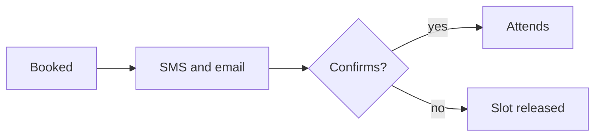

# Making a booklet

**Skill version: 0.13.0**. It matches SPEC.md's v0.13, the current format.

A **booklet** is one Markdown file, named `<slug>.booklet.md`, that holds a
person's work *and* the design of the activities they do in it. The design is
ordinary Markdown that a person reads and edits in any text editor. What the
person answered is kept in a records section at the end of the same file, which
a renderer writes and a person leaves alone. A renderer (the Booklet page,
`booklet.html`) draws the activities from the file, and saves the person's
answers back into it. This skill turns a plain request into such a file with
nothing else to hand. `SPEC.md` in the Booklet repository is the full format.
You should not need it, but section 13 points at it for anything this skill does
not cover.

**Hard rules.** Break one and the file is invalid, or it looks valid and
misbehaves:

1. Activities, modules, questions and menus are addressed by **id**. Ids are
   permanent, and hold only letters, digits and dashes. A question's options and
   anchors are addressed by position (section 6).
2. A booklet's design is **callout lines and prose**. A booklet with nothing
   answered yet holds JSON only in a widget's data and in a data block, both
   fenced and both explained below. The app's own record of what was answered is
   JSON too, and only a renderer writes it.
3. A module is fenced (`> [!module|id] Title` … `> [!module|id end]`),
   and holds **one activity, or several**, each opened by its own
   `> [!activity|id …] Title` line. Every activity is written the same way.
4. **Tabs are a tab line, pages a horizontal rule** (`***`). A tab
   (`> [!tab] Name`) is an area of an activity or a module meant to be very
   different from the rest; a page is only pagination, for a long form or a
   long reading. A short activity needs neither.
5. **One language per file.** Nothing here is written per-language; a
   translation, if one is wanted, is a sibling file (section 9).
6. You write the design only. **Never write answers, kept entries, names or
   emails.** Those live in the records section, which only the renderer
   writes, wrapped in `%% … %%` so Obsidian's Reading view hides it.
7. It is a **learning format, not a clinical tool** (see section 2).

---

## 1. What is in the file

Booklet > modules > activities > (tabs, by a tab line) > (pages, by a rule) > booklet lines and prose.

- A **module** is what a person adds or removes as a unit — the whole fence,
  `> [!module|id] Title` to `> [!module|id end]`.
- An **activity** is one thing a person does and keeps. `repeat` after its id
  keeps each completion as a dated entry; `repeat daily` keeps one entry per
  day, replacing today's on a second finalize; with neither, the activity is
  answered once and edited in place, with one current answer and no history.
- **Tabs** split an activity into areas meant to be very different: a
  dashboard, a form, a reading. `> [!tab] Name` starts a tab that runs to the next
  tab line or the end of the activity; what comes before the first tab line is the
  activity's opening, shown above the tabs. A module's opening can declare tabs
  too, and its activities join them with `tab:` (section 5).
- **Pages** paginate a long form or a long reading. Any thematic break inside an
  activity or a tab is a page break; an activity with no break is one page. A page
  has no name and no menu: the reader moves through pages with Back and Next.
  ⚠️ Write `***` on its own line, not `---`: a bare `---` right under a line of
  text is read by Markdown as that line's heading instead.
- **Booklet lines** (`> [!kind|id …] Title`) are everything Booklet needs to
  know about: an activity, a question, a widget. Everything else — headings,
  paragraphs, lists, a citation mark — is ordinary Markdown, read as prose.

The file has three parts, in order:

| Part | Holds | Who writes it |
| --- | --- | --- |
| **Front matter** (`---` on line 1) | `booklet: "0.13"`, `id`, `title`, `lang`, `version` | you |
| **Design** (everything above the records) | the readable prose, and every `> [!…]` line and its fenced data | you; the renderer never rewrites your design |
| **Records** (inside `%% … %%`, at the end) | what was answered, fenced and grouped by module | the renderer only; a fresh file has none at all |

**Never invent or edit:** kept entries or answers, a `sync` record, a module's
`notice` terms nobody gave you, a kind or engine not listed here. When changing
an existing booklet, edit only the design above the records section, keep every
id exactly as it was, and never touch anything inside `%% … %%`.

---

## 2. Scope and safety

Booklet is a **consumer format for learning, study, habits and reflection.
It is not a clinical tool.**

- **Do not write** diagnosis, screening, symptom or mood scores, treatment or
  therapy exercises, medication advice, safety plans or crisis handling.
- **Do not ask for** identifying information (full name, address, phone,
  school or employer, ID numbers, date of birth) or health information
  (symptoms, conditions, diagnoses, medication, weight or other body
  measures).
- **Open questions about the day are fine** ("What went well?", "What was
  hard?"). Mood ratings, feelings checklists and symptom questions are not.
- **Keep the tone plain and kind.** Short sentences, second person. No
  scores, streaks, grades or shaming. Skipping is always allowed, and the
  opening line of prose says so.
- **Wellness habits** (water, sleep, walking) are fine as a plain log of what
  happened, counts included ("How many glasses today?"). Do not set targets,
  prescribe amounts or give health advice; if an amount matters, say it is
  worth asking a professional.
- **Study content must be correct.** Keep readings short, write them
  yourself (do not paste copyrighted text), and say in your reply if anything
  is uncertain.
- **If the request is clinical** (for example "a symptom tracker for my
  clients" or "a CBT worksheet for panic attacks"), do not build it. Say
  plainly that Booklet is not a clinical tool, and offer a non-clinical
  version (a general reflection journal, a study set about the topic, a habit
  log) for the requester to choose.

---

## 3. Procedure

**Step 1. Ask the few questions that matter**, in one message. If you cannot
ask (no one will answer, or none comes), use the defaults and list them as
assumptions in your reply.

| Ask | Default |
| --- | --- |
| Who is it for (age, level)? | an adult or older teen, plain language; a language learner is a beginner to intermediate |
| Which one language should it be written in? | the one the request asks for, else the one it is written in; for a language learner, the language being learned; Spanish is neutral `es` unless Argentina is named |
| What should be **kept** (answered each time) and what just **read**? | questions are kept; readings stay readings |
| How long, and how often? | 5 to 10 minutes; once a day for journals and trackers |

If the requester may want **another language later**, write only the one
asked for now, and tell them a translation is a sibling file (section 9).

**Step 2. Decide the structure, top down: modules, then activities, then
pages, then booklet lines.**

| Decision | Rule |
| --- | --- |
| How many **modules**? | One, unless the parts are independent and a person might want one without the other (a journal and a separate tracker). |
| How many **activities**? | One per thing done in one sitting and kept as one entry. Parts done at different times (a daily log and a weekly review) are separate activities. |
| Which **flag**? | `repeat` for anything with a dated history. `repeat daily` for once a day, replacing today's entry on a second finalize. No flag for reading, or for a question with one current answer and no history. |
| Tabs, pages, or neither? | Neither, for most: one scrolling page, enough for up to about seven lines. Tabs only for areas meant to be very different (a dashboard, a form, a reading). A break (`***`) only to paginate a long form or a long reading, 2 to 4 pages. |
| Which **lines**? | Open with a line or two of plain prose: what to do, roughly how long, and that anything can be skipped. On a page that asks questions, 3 to 6 of them, mostly `text` (section 6). |

A **quiz** has no scoring, but a `choice` or `multi` may mark its correct
option or options with `[x]` (section 6): once the reader has answered, they see
whether they were right (a `multi` has a Check button), and nothing is scored or
stored. The correct option is visible to anyone who opens the file as text, so
use `[x]` for study material, never for anything that has to stay hidden.
Put the explanation of the right answer in a folded `> [!solution]-` callout
directly under the question (section 6), or in ordinary prose on the next page.
A **matching** quiz lists the
options in prose (a word bank, in a different order from the questions), then
asks one `text` question per item. A **review** asks the person to recall or
explain in their own words, and what they would look at again. A **tracker**
is a `repeat daily` activity with a few short questions. For **language
learners**, use simple words and short sentences, and give an example answer
in the help text under the question.

**Step 3. Write the file**, from the skeleton in section 4, as
`<slug>.booklet.md` (slug: the title in lowercase ASCII words joined by
hyphens, accents dropped: `registro-de-agua`).

**Step 4. Validate** (section 11) and fix until clean.

**Step 5. Reply** with: the file path; the structure in a line (modules,
activities, pages); the assumptions you made; the lint result; and how to
open it (load the file in the Booklet renderer, `booklet.html`).

---

## 4. The file skeleton

Copy this and change the words. It lints clean as it stands, so the ids and the
language are real ones; give them your own.

````markdown
---
booklet: "0.13"
id: "local/my-booklet"
title: "My booklet"
lang: en
version: "0.1"
status: draft
---

# My booklet

One or two plain sentences: what this booklet is for.

> [!module|my-module] My booklet

One or two sentences about this module. The first paragraph is also the blurb on the module's card.

> [!activity|my-activity] My first activity

One or two sentences of plain prose: what to do, and that skipping is fine.

> [!text|my-question] Your first question

> [!module|my-module end]
````

Write one booklet line for each question (section 6) where `my-question` stands.

- **`booklet`** is the format marker. Write it in quotes, `booklet: "0.13"`:
  unquoted, a YAML tool reads `0.10` as the number 0.1. A tool that writes
  booklets should ask the linter for the marker (`python3 lint-booklet.py
  --marker` prints the whole line) and not hard-code it. A file marked with
  another `0.x` version still opens, with a notice and no promise, but write the
  current marker.
- **`start: home`** (optional, in the front matter). A booklet that is one
  activity or one module opens straight into it. Add `start: home` to keep the
  home screen.
- **`status: draft`** is right for anything an AI wrote. The linter does not
  check this field for an ordinary booklet — it is a convention, not an
  enforced rule — but the `booklet-registry` repository, where modules are
  published, offers only `approved` modules, so a draft stays out until a
  person changes it to `approved` after reviewing.
- **`id`** is `local/<booklet-slug>` (or `<namespace>/<slug>` if the
  requester has one). It names the booklet across any future translation or
  version; it is not the module's own callout id (section 5).
- **`lang`** is the one language the file you are writing is in: `en`, `es`,
  `es-AR` or `fr`. There is no `languages` list: a module is written in one
  language. (In a booklet that holds several modules, `lang` only sets the
  language of the renderer's own menus and defaults; it says nothing about the
  modules.)
- **Module end line.** Write `> [!module|my-module end]` with no title. Any words
  after `end]` are for whoever edits the file and are never shown.
- **Notes for whoever edits the file** go in an HTML comment (`<!-- … -->`),
  which is never drawn.
- **Images.** An image is linked, never embedded. A renderer fetches one only
  from a place its own host declares, never from an address the file names. The
  reference renderer shows the alt text and the address as text, and the linter
  warns on a remote address (section 7).

### Where each title and opening shows

| You write | It shows |
| --- | --- |
| the front matter's `title` | as the booklet's name: its home screen, its row in a list of booklets, the saved file's name |
| `# Title` and the prose above the first module or activity line | as the booklet's opening, on the home screen under the title (a `# Title` that repeats the title is drawn once) |
| the module's title, the words after `]` on its opening line | on the module's card, and as the heading of its own screen |
| prose inside the module before its first activity | as the module's opening, on the module's own screen above its activities; its first paragraph is also the card's blurb |
| the activity's title | on the activity's card on its module's screen, and as the heading of its own page |
| the activity's first paragraph | on its card, under the title |

A module that holds one activity is named by the module's title, and the
activity's own title is not drawn. If the module will hold only that activity,
give both the same words. A booklet of one
module opens straight into the module, so the home screen, and the booklet's
opening with it, shows when the reader presses Back. Write the booklet's opening
for a reader who has not opened the module yet.

**Headings.** Headings never decide modules, activities, pages or answers. A
heading is ordinary reading, and a `##` there does not turn the text into a
module. A heading is drawn as a heading, and the renderer reads it in two more
ways: it starts a cell in a row, and a heading link can open it. Nothing is folded
by a heading: only a callout the author folds with `-` is folded.

---

## 5. Modules and activities

```markdown
> [!module|my-module] The module's title

Optional: prose here, before the first activity, is the module's opening.
It is drawn on the module's own screen above its activities (its first
paragraph large) and nowhere else, and its first paragraph is the module's blurb.

> [!activity|my-activity] The activity's title
```

- The **module's id** (after `|`) is letters, digits and dashes only —
  `daily-journal`, not `daily_journal` or `Daily Journal`. It is unique
  within the file and across a person's whole collection: adding a module
  whose id already exists replaces the old one.
- **A module may carry its notice**, the terms it is shared under, inside its
  fence before its first activity: a `> [!notice]` callout whose lines are
  `key: value` for `license`, `copyright`, `source` and `version` (any may be
  left out; nothing else goes in it, and it takes no id). A file that holds one
  module and no callout is covered by its front matter's `license`, `copyright`
  and `source` (never `version`: the file's version is the file's), so a module
  file needs no change. Never invent terms nobody gave you; copy a module's own
  notice, do not write one.
- The **module's title** is the words after the id, on the same line. Where it
  shows is in section 4.
- **A bare activity needs no module fence at all.** A file with no
  `> [!module|…]` line is bare activities only — fine for a one-off
  worksheet with a single activity.
- **Several activities that belong together** (a study week) share one
  module fence; each still opens with its own `> [!activity|…]` line.
- **An activity's id** is a short name (`walk-notes`, `learn`): lowercase
  letters, digits, dashes; unique **within its module** (two modules may each
  have an `intro`, and neither sees the other's; the same holds for question,
  menu and block ids). The id is the **first word** after the bar, so any word
  will do, and no id is reserved (not even `home`).
- **Flags** (after the id, space-separated): `repeat` (kept as a dated
  entry), `repeat daily` (one entry per day), `hidden` (kept in the file, not
  offered). With none of these, the activity is answered once and edited in
  place. `daily` needs `repeat`.
- **A picture for a card: `icon:`** on a module or activity line names a
  picture from Booklet's icon set: `> [!activity|log repeat icon:notebook-pen]
  Log a moment`. Without it a leading emoji in the title is the picture, and
  without that the card's number. A name outside the set is an error in the
  linter, so choose one from the list below and never invent one. A module's own
  `icon:` goes on its opening line, never on its end line, and is drawn large
  beside its title: `> [!module|loop icon:refresh-cw] Mapping the loop`.
- **An activity under another: `parent:`** names the activity it belongs under,
  in the same module, for a module that is a tree of pages (a wiki, a
  portfolio). Write the parent first:
  `> [!activity|v1-release parent:booklet-dev] Booklet v1.0`. Without `parent`
  a module is a flat list. A parent that is not in the module, or a loop, puts the
  activity at the top and the linter warns.
- **A link to a whole module**, one that may not be in this booklet, is
  `[[week-2.booklet]]` or `[Week 2](week-2.booklet.md)`: the module's id is the
  file's name before `.booklet`. Add a label after a bar,
  `[[week-2.booklet|Week 2]]`; without one the link shows the bare id. A renderer
  opens it if the booklet holds it and shows it as not here otherwise. Use
  `[[#Heading]]` to move within a file.

The icon names, all of them:

<!-- icons:start -->
`activity` `anchor` `archive` `arrow-left` `arrow-right` `award` `badge-check` `bed` `book`
`book-open` `bookmark` `box` `brain` `briefcase` `bug` `calendar` `calendar-clock` `camera`
`chart-column` `chart-line` `chart-pie` `check` `chevron-down` `chevron-left` `chevron-right`
`chevron-up` `circle` `circle-alert` `circle-check` `circle-dashed` `circle-dot` `circle-help`
`clipboard-list` `clock` `cloud` `code` `coffee` `cog` `coins` `compass` `contrast` `database`
`download` `droplet` `ear` `ellipsis` `external-link` `eye` `feather` `fence` `file-text` `flag`
`flame` `flask-conical` `folder` `folder-open` `footprints` `gauge` `gavel` `gift` `git-compare`
`glasses` `globe` `graduation-cap` `hammer` `hand` `hand-heart` `handshake` `hash` `heart`
`hourglass` `house` `image` `inbox` `info` `key` `landmark` `layers` `layout-grid` `leaf`
`life-buoy` `lightbulb` `link` `list` `list-checks` `list-ordered` `list-tree` `lock` `mail` `map`
`map-pin` `menu` `message-circle` `messages-square` `mic` `microscope` `milestone` `minus` `moon`
`mountain` `music` `notebook` `notebook-pen` `octagon-alert` `package` `package-plus` `palette`
`pause` `pen-line` `pencil` `phone` `piggy-bank` `play` `plus` `puzzle` `quote` `refresh-cw`
`repeat` `rocket` `rotate-ccw` `route` `ruler` `scale` `scissors` `search` `send` `settings`
`shapes` `shield` `ship-wheel` `shuffle` `signpost` `sliders-horizontal` `smile` `sparkles` `sprout`
`square-check` `star` `stethoscope` `sticky-note` `sun` `sunrise` `table` `target` `telescope`
`tent` `thumbs-up` `timer` `traffic-cone` `trees` `triangle-alert` `trophy` `umbrella` `user`
`users` `wallet` `waves` `wind` `wrench` `x` `zap`
<!-- icons:end -->

A small wiki, three pages in a tree and a link to a module the booklet may not
hold. The renderer draws the top page as a card, the tree in a menu beside the
pages, a trail of ancestors above each page, the pages under it as cards below,
and a "Mentioned on" list of the pages that link to it:

```markdown
---
booklet: "0.13"
id: "local/harbour-notes"
title: Harbour notes
lang: en
version: "0.1"
---

> [!module|harbour icon:anchor] Harbour notes

> [!activity|tides icon:waves] Tides

How the water moves. The two tidal ranges are in [[#Spring tides]]; a second week of
the course is in [[week-2.booklet]].

> [!activity|spring parent:tides] Spring tides

The widest range, twice a month. Back to [[#Tides]].

> [!activity|neap parent:tides] Neap tides

The narrowest range. Compare [[#Spring tides]].

> [!module|harbour end]
```

An activity with pages (pages paginate; the answers of all its pages are
kept together as one entry):

```markdown
> [!activity|rd-tides repeat] Read and check

> [!text|noticed] What surprised you?

***

> [!choice|biggest] When are the biggest tides?
- [ ] At the quarter moons
- [ ] Near the new and the full moon
```

Everything from the activity line up to the next `***`, tab line, activity line
or module-close line is page one; everything after the `***` is page two, and so
on. A page has no name, no id and no menu: the reader moves through the pages
with Back, "Page 2 of 3" and Next at the foot, and Next on the last page goes on
to the next activity. A heading on a page is just a heading.

An activity with tabs, for areas meant to be very different (a tab is
presentation too: the answers of every tab are kept together as one entry):

```markdown
> [!activity|budget] My budget

Everything here stays on this device.

> [!tab] This month

> [!number|spent] Spent so far

> [!tab|learn] Why a budget helps

A budget is a plan, not a judgement.
```

- **A tab's id** is the one after the bar, else its name as an id (`This month`
  is `this-month`; accents go, and letters outside a to z go as punctuation does,
  so for a name in Greek or Chinese write the id: `> [!tab|nihongo] 日本語`). Two
  tabs of one activity with one id are an error in the linter; give each its own
  name, or an id.
- **What comes before the first tab line** (here, "Everything here stays…") is the
  activity's opening, shown above the tab bar on every tab.
- **Use tabs only for areas that differ in kind.** Steps of one task are not
  tabs; a long form is pages, a short one neither.
- **A module's tabs**: tab lines in the module's opening (before its first
  activity) declare them, and an activity joins one with `tab:<id>` on its line;
  with no `tab:` it is in the first. Prose after a tab line in the opening is
  shown above that tab's activities. A `tab:` naming no tab of its module is an
  error in the linter. A module of one activity has no screen of its own, so it
  has no tabs to show: put tabs inside the activity instead (the linter warns).

```markdown
> [!module|money] Money

> [!tab] This month

> [!tab|learn] Learn

> [!activity|spending tab:this-month] Spending

> [!activity|why-budget tab:learn] Why a budget helps
```

**The frame.** Plain prose before an activity's first question (a tab's, when it
has tabs: paragraphs, lists and tables, with no heading, callout, HTML or code
fence) is its frame: the renderer keeps it in view while the questions are
answered. One at a time, it is drawn whole above the question on show, however
long. All at once, it is held at the top while they scroll, but only when it
fits whole in that space: four lines of text at the renderer's usual size
(fewer on a window under about 580 pixels high), or a key of a header row and
two rows to a scale; a third row is too tall. **Instructions are short**: a
sentence or two of what to do, or that two-row key. Longer prose is reading when
the questions are all shown, and scrolls with its page whole, nothing cut. So is
prose between two questions (it goes with the question after it), and reading
with a heading or a callout before the first question. `pin:off` on the activity
line lets the frame scroll away like any prose: `> [!activity|walk pin:off] Walk notes`.

---

## 6. Booklet lines: the questions

A booklet line is `> [!kind|id …] Title`. The **title is the question
itself**. **Help text**, if you want some, is a continuation line right under
the question line, each starting with `>`, no blank line between; a renderer
shows it under the prompt.

```markdown
> [!text|noticed] What did you notice?
> One thing is enough: a sound, a colour, a smell.
```

| kind | Use it for | Needs under it |
| --- | --- | --- |
| `text` | a written answer | nothing; `long` after the id for a bigger box |
| `lines` | repeated one-line notes | nothing; stores under its own id, like any other question — an activity may have more than one |
| `choice` | pick one | a task list, `- [ ] Option`; `[x]` marks the correct one, and `open` after the id lets the reader add their own |
| `multi` | pick any number | a task list; `[x]` marks each correct one, and `open` after the id lets the reader add their own |
| `scale` | a numbered scale | a numbered list of anchors, starting at whatever number you want the scale to start at (usually `0.`) |
| `matrix` | several items on one shared scale | a bulleted list of items, then a numbered list of anchors |
| `number` | a number | nothing; `min:`, `max:`, `step:` after the id |
| `date` | a date | nothing |
| `widget` | a drawing engine (a body map or a grid) | an embed of the widget's data — section 9, and never invent one |

```markdown
> [!choice|biggest] When are the biggest tides?
- [ ] At the quarter moons
- [ ] Near the new and the full moon
```
```markdown
> [!multi|outside open] What did you do outside today? Add your own.
- [ ] Walked
- [ ] Gardened
```
```markdown
> [!scale|clarity] How clear was the reading?

0. Not clear
1. A little clear
2. Fairly clear
3. Clear
```
```markdown
> [!matrix|topics] How sure are you of each topic?

- Spring tides
- Neap tides
- Tidal range

0. Not yet
1. Getting there
2. Sure
```
```markdown
> [!number|sleep min:0 max:24] Hours slept
```

**A hint and a solution** are callouts that belong to the question straight
above them. Fold both with `-`, and put them directly under their question, with
no prose in between.

- `> [!hint]- Hint` helps *before* the reader answers. It opens only when the
  reader asks.
- `> [!solution]- Solution` explains *after* the reader has answered. Under a
  `choice` or `multi` with an `[x]` it opens by itself once the reader answers
  (for a `multi`, when the reader presses Check). Under a `choice` with no `[x]`
  it opens by itself on a pick, in a neutral tone. Under any other question it
  opens when the reader asks.

```markdown
> [!choice|biggest] When are the biggest tides?
- [ ] At the quarter moons
- [x] Near the new and the full moon

> [!hint]- Hint
> Think about when the sun and the moon pull in the same direction.

> [!solution]- Solution
> At the new and the full moon the sun and the moon line up, so their pulls add together.
```

**A list used by several questions is written once, as a menu.** Put a
`menu` line and its bulleted list inside the module whose questions use it, or
under a `> [!data]` line for every module to use, and name it on each question
with `menu:<id>`. The question has no list of its own; `open` still works. The menu
itself is never shown.

```markdown
> [!menu|places]
- Park
- Garden
- Library

> [!multi|morning menu:places open] This morning I went to…

> [!choice|evening menu:places] This evening I went to…
```

- **A numbered list that does not start at `1.` needs a blank line above it**,
  as a `scale` that starts at `0.` does. Markdown only lets a list starting at
  `1.` interrupt a paragraph directly; any other number is swallowed into the
  question's title without the blank line. A task list or a bulleted list never
  needs one.
- **A `choice`'s options are identified by position, not text.** The second
  option is always the second option; if you ever add or remove one, treat
  the question as a new one with a new id, since existing answers point at a
  position.
- **A question is never hidden by a file, and the renderer folds nothing on
  its own.** There is no way to write "optional questions, folded shut until
  opened". If a request calls for that ("a couple more if you want them"), put
  the extra questions after the ones that matter, under their own heading, or on
  their own page after a `***`. Extra reading can be folded by the author: a
  `> [!group]- More on this` callout. A reader who would rather not click has
  one switch that opens every such fold on the page.
- **No question takes its options from another activity's answers.** There is
  no kind that draws a list of options pulled live from a different activity's
  answers, or a tick-list of what was done. (A `booklet query` can show another
  activity's kept entries: section 7.) If a request needs such a list, say so
  plainly and offer a plain `text` or `lines` question instead, in the same
  activity.
- **A `matrix`'s answer is one anchor number per item, by position.** Items
  are identified by position like a `choice`'s options, and a matrix's
  anchor numbers must not repeat. Give it a title that reads as the stem
  ("How sure are you of each topic?") and one short phrase per item.

---

## 7. Reading: prose, headings, quotes and citations

Everything that is not a booklet line is ordinary Markdown, read exactly as
written: `# `/`## ` headings, paragraphs, **bold**, lists, and a blank line
between paragraphs for a new one. Section 4 says what a heading does.

- **A pull-quote or a note set apart** is an Obsidian-style callout:
  `> [!note] …`, `> [!tip] …`, `> [!warning] …`, or Booklet's own `diff`
  (where a guide differs from this reading), `law` (a rule as it stands) or
  `opinion` (an author's view), and `group`, the plain fold: `> [!group]- Title`
  folds reading content shut until opened — fine for background material nobody
  has to read, never for a question (section 6). Any callout kind written with
  `-` folds the same way.
- **A citation is an ordinary footnote** — `[^id]` in the text, and its
  definition anywhere in the file:

  ```markdown
  Most harbours see two high tides a day.[^atlas-12]

  [^atlas-12]: *The Harbour Tide Atlas*, 2nd edition (2019), p. 12: "The tide rises and falls twice in each lunar day." Verified 2026-09-20.
  ```

  Write the note as *Title* (italic), then optionally an edition or detail,
  then the page, then the quote **in quotation marks, copied word for word**,
  then optionally `Verified YYYY-MM-DD.` if a person actually checked it.
  The renderer reads that shape into a numbered mark and a side panel — there is
  no separate registry to write.
  **Never invent a citation.** Cite only a document the requester gave you,
  quoted exactly; leave off `Verified` unless someone actually checked it.
  With no document to hand, write plain reading with no citations at all.
  If they gave a reference and no quote, write the note as that reference, as
  given, with no quote and no `Verified`, and never make a quote up: the
  panel shows it as a plain reference, its words as written, with no check. Put nothing else in a note (`*` stays as typed).
- **A link to another activity** is an ordinary heading link: `[[#Log a moment]]` (or `[[#Log a moment|go on]]`) or `[Log a moment](#log-a-moment)`. It opens the first place in its own module whose heading or title reads those words (a heading, an activity's title, a tab's name, a question's prompt or a callout's title), on the right tab and page (a module's tab name opens the module's screen on that tab); the linter warns when nothing in the link's own module reads those words.
- **Showing what was kept** — a `booklet query` block, in the prose of one
  activity, shows what the reader kept in another activity **of the same
  module**. It is read-only and takes no answer. The kind goes on the fence
  line and every setting is a `key: value` line:

  ````markdown
  ```booklet query
  from: log
  fields: situation, ease
  limit: 3
  empty: Nothing logged yet.
  ```
  ````

  `from:` is required: an activity that is `repeat` or `repeat daily` (its
  kept entries, newest first), or one question's id (its answers).
  `fields:`, `limit:` (the newest that many) and `empty:` are optional. Never point it at another
  module, and never write anything else in the block. In Obsidian without a
  plugin it shows as a plain code block, so say in the prose above it what it
  will show.
- **A report page from data** — numbers that something else already worked out
  (counts, due dates, a status per item) go in a `booklet data` block: JSON,
  an object with `rows` (flat objects: a string, number, `true`, `false`, or a
  list of those) and optionally `fields` (each key's label, which is also the
  column order), or just the list of rows, with a `^id` on the line after the
  fence. Put it inside the
  module, in the module's own data section at the end (`> [!data|<module-slug>]`,
  the way records are tagged by module), or in the shared data section
  (`> [!data]`). A `booklet query` then draws it
  with `as:` set to `table` (the default), `list`, `tiles`, `cards`, `bars` or `line` (`cards` draws a card per row: its `label` is the title, its other fields the lines). **Write the rows
  already ordered and counted: nothing is added up or computed when the page
  is drawn.** A reader may sort and filter what is on screen; the file never
  says how.

  **Name the fields for the part they play, and the query is two lines.** A row
  has seven roles: `label` (its name), `value` (its main figure), `note` (a
  quieter second line), `badge` (a short word, drawn as a pill; a list is
  several pills), `tone` (`good`, `warn` or `bad`), `link` (where the row
  leads: `#Heading`, a module file such as `week-2.booklet.md`, or a web address, as a link in prose) and `icon` (the row's picture, a name from the
  icon set). `table`, `list`, `tiles` and `cards` draw the last two; `bars` and `line` do not. A tile strip that leads to pages is
  rows of `label`, `link` and `icon` (`link` `#Home visits`, `icon` `house`). Each is read from the
  field of the same name, and the label falls back to the first field, so rows
  written with those names need only `from:` and `as:`. If the fields are
  already named something else, a line such as `label: bucket` points a role at
  one. Every view reads the same roles, and `fields:` always means the other
  fields to show.

  ````markdown
  ```booklet query
  from: status
  as: tiles
  ```

  ```booklet query
  from: jobs
  as: list
  group: when
  fields: where
  limit: 10
  ```

  ```booklet query
  from: jobs
  as: table
  fields: task, when, where
  ```

  ```booklet data
  { "fields": { "task": "Job", "when": "When", "where": "Where" },
    "rows": [ { "task": "Mend the gate", "when": "This week", "where": "Fence" } ] }
  ```
  ^jobs
  ````

  `tiles` draw a big value over a label, or, when no row has a value, a
  short pill each (a status strip). `list` draws each row on one line: badge, label, the other
  fields, the value at the right, the note beneath. `group:` gathers rows under
  a field's value, in the order they first appear. `parent:` names the field
  holding the `id` of the row this one sits under. All text is plain: no
  Markdown or HTML in a value.
- **A chart from data** — the same data block can be drawn as a chart. `as: bars`
  draws one bar per row (`label:` names the field that names the bar, `value:`
  the field that gives its length, optional `tone`); `as: line` draws the rows,
  in order, as points left to right (`label:` names the field along the bottom,
  `fields:` one or more number fields, each its own line). Write the rows in the
  order they should appear; the chart adds nothing up. A value that is not a
  number draws nothing (a gap in a line). Every chart can show its numbers as a
  table, and a number or scale question of a repeat activity works as a line too
  (`from:` the activity, `label: date`). One of each:

  ````markdown
  ```booklet query
  from: by-bucket
  as: bars
  label: bucket
  value: count
  ```

  ```booklet query
  from: sleep-log
  as: line
  label: date
  fields: hours
  ```
  ````
- **An image** is reference style, with its address at the end of the file:
  `![The harbour at low water][harbour]` and, near the other data,
  `[harbour]: images/harbour.jpg`. Use a relative path the requester gave you.
  Never embed the data, never invent an address, and avoid an `https` address:
  the linter warns on one, and a renderer fetches an image only from a place its
  host declares (section 4).

- **A report** (something written to be read, with numbers and perhaps a few
  questions at the end) has its own section, 8.

---

## 8. Reports and reading booklets

A **report** is a booklet made to be read: a briefing, a status page, a study
guide, with numbers, charts, diagrams and formulas and perhaps a few questions
at the end. It is still a learning format, not a clinical tool (section 2). It
needs only front matter and Markdown: with no activity line, the whole file is
one activity named by its title. Notes to yourself go in `<!-- … -->`; they are
not drawn. Section 12 ends with a whole report.

**Choose the shape.** A report reads top to bottom, open: the renderer folds
nothing on its own, and its headings are drawn as headings. Fold only what a
reader may skip, with a `-` callout (`> [!group]- The detail`); a reader who
would rather not click has one switch that opens every such fold on the page. A
reader may take a page of three or more questions one at a time.

- **One activity, the questions last.** The answer for every report. The
  booklet opens straight into it and nothing is blank. Split a long one into
  pages (`***`), which the reader turns with Back and Next; put the questions and
  the data views together at the end (or on the pages that need them).
- **Two activities** only when the reader really needs two separate things (a
  report to read and a log to keep with `repeat`, say), never just to split the
  reading. The booklet then opens on the module's screen with a card for each
  activity. A card shows its activity's title and, under it, the activity's
  first paragraph (the line right under its title, read as inline Markdown), so
  open each activity with one sentence that says what it is for, and title
  each for what the reader does ("Read the briefing", "Give your view"). An
  activity with no paragraph first shows its title alone.

**Lead with the answer.** The first page says the verdict in one sentence,
then the headline numbers as tiles, then the detail. A folded callout shows only
its title until it is opened, so title it for what is inside.

**Data: which view for what.** Rows are written already ordered and counted;
the page adds nothing up (the queries and roles are in section 7).

| Data | `as:` | Reads |
| --- | --- | --- |
| headline figures | `tiles` | `label`, `value`, `note`, `tone` |
| status words | `tiles`, rows with no `value` | `label`, `tone` (a strip of pills) |
| status rows | `list` | `label`, `badge`, `tone`, `value`, `note`, `fields:` |
| a comparison | `table` | `fields:` (the columns) |
| categories | `bars` | `label`, `value` |
| a series over time | `line` | `label:` (along the bottom), `fields:` |

- **A value may be text**, shown as written: `"$38,500"`, `"8%"`. In tiles,
  lists and tables a number shows bare (`38500`), so write money and percentages
  as text there.
- **Bars and lines need real numbers.** Text such as `"15,000"` draws nothing
  (the linter warns). They show the number with thousands separators and no
  unit, so say the unit in the label (`"Hire (USD)"`); for a line, in the
  field's label in the data block's `fields` (`"Revenue ($)"`), which names it.

A module's data goes in its own data section, after the module's end line:

````markdown
> [!module|reminders end]

> [!data|reminders] Data

```booklet data
[ { "label": "SMS only ($ a month)", "value": 17820 },
  { "label": "Add email ($ a month)", "value": 12960, "tone": "good" } ]
```
^cost
````

A page draws one with a `booklet query` block (`from: cost`, `as: bars`).

**Diagrams.** A `mermaid` fence in the prose is drawn. To keep long diagram
source out of the prose, put the fence in the data section, put `^id` on the
line after it, and place it with `![[#^id]]` on a line of its own. Prefer the
fence in the prose when in doubt: it draws everywhere. `flowchart`,
`sequenceDiagram`, `pie`, `timeline`, `stateDiagram-v2`, `classDiagram` and
`erDiagram` draw well; `gantt` and `journey` draw cramped, and `mindmap` is not
drawn (its source shows). A diagram with an image, a link, a style or a `click`
could make the page ask for an address, so it is not drawn and its source shows
instead.

**Formulas.** `$…$` is inline and `$$…$$` is a display formula. Ordinary TeX
works: fractions, sums, roots, Greek letters, `\text{…}`, `cases`, matrices,
`aligned`. TeX it cannot read, and `\href`, shows as code. A `$` opens a formula
when a non-space follows it, and the formula ends at the next `$` that follows a
non-space and is not followed by a digit. So "costs $5 and $10" and "$38,500 of
$60,000" stay prices, but "$5 a month ($)" turns into a formula. **Write every
price in prose as `\$5`**: it is always a dollar sign. This holds in a
title, a help line, an option and an anchor too, because the words on a
booklet line are inline Markdown (below). In a data value, write a plain `$`.

**Marks on a booklet line.** The words on or under a booklet line (a title,
a question's help text, an option, a scale's anchor, a matrix's item) are
inline Markdown, as the prose around them is: `*emphasis*`, `**bold**`,
`` `code` ``, `[a link](https://example.org)` and `$math$` all draw, so a
maths question can say `> [!choice|bigger] Which is bigger, $\frac{2}{3}$ or
$\frac{3}{5}$?`. A button or a card shows a link as its words only. Data
values are plain text.

**Sources and numbers.** Citations are footnotes (section 7). Numbers are
written in, never computed: say where each came from, and state any assumption
behind a worked figure ("assumes one reminder per visit").

---

## 9. Widgets, languages, and the file name

**Widgets.** A `widget` line draws with data for one of the renderer's two
engines — `svg-regions` (clickable figures) and `grid-select` (a grid of
words) — embedded right in the file:

````markdown
> [!widget|grid] Effort and impact
> ![[#^effort-impact]]

```booklet widget
{ "engine": "grid-select",
  "axes": { "top": "more effort", "bottom": "less effort", "left": "less payoff", "right": "more payoff" },
  "cells": [ { "id": "quickwin", "label": "Quick win", "note": "Cheap and worth it." } ],
  "items": [ { "id": "reply", "cell": "quickwin", "label": "Send the one-line reply" } ] }
```
^effort-impact
````

**Do not invent a widget or an engine.** Copy one whole, unchanged in shape,
from an existing module in the `booklet-registry` repository's `modules/`
(they carry their own widgets inline) — only the wording inside it is yours to
translate or reword, never its `engine` or its structure. A new engine is a
change to the renderer, not to a booklet. Without a widget file to copy,
build the activity from `text`/`choice`/etc. instead.

**Languages.** Every booklet is written in exactly one:

| Tag | Language | Notes |
| --- | --- | --- |
| `en` | English | |
| `es` | Spanish, neutral Latin American | use `tú` |
| `es-AR` | Argentine Spanish | use `vos` throughout, not `tú` |
| `fr` | French | use `vous`; a space before `? ! : ;` |

- **A translation is a sibling file**, `<slug>.<lang>.booklet.md`, with the
  same `id`, the same module and activity ids, and the same number of entries
  in every list (a `choice`'s or `multi`'s options, a `scale`'s anchors, a
  `matrix`'s items and anchors, a menu's entries), **in the same order**, so
  answers carry across the sibling files unchanged. Write each
  language as a native speaker would, not word for word: natural phrasing,
  local examples, the language's own punctuation (`¿…?`, `¡…!`).
- **Flag your non-native writing.** In your reply, if you wrote in a
  language other than the one the request was written in, say so and name
  it as needing a native speaker's check; leave `status: draft`.
- Region spellings are `es-AR`, `fr-CA` (lowercase language, uppercase
  region). Another well-formed language (`de`, `pt-BR`, …) is allowed, with a
  warning that the renderer's own buttons will be in English around it.
- **A module for the `booklet-registry` repository is one language too**,
  like any other booklet.

**File name.** `<slug>.booklet.md`, from the booklet's title, dropped-accent
lowercase words joined by hyphens. A reader also accepts a plain `.md`.

---

## 10. Layout and look (optional)

- **Rows.** `> [!row]` … `> [!row|end]` lays what is between them side by side when there is room: each heading at the shallowest level inside starts a cell. Use it for two or three short things that belong together (two tables, a question beside its note). Never inside another row, and never across a page break (`***`), an activity line or a module fence.
- **Widget colours** are colour names: `"color": "warm"`, `"green"`, `"amber"`, `"slate"` or `"teal"`, never hex colours (they are no colour), so a widget reads in every theme.
- **A theme block** (`booklet theme`, one per file, outside any module, lines of `key: value`: `base`, `paper`, `ink`, `accent`, `good`, `warn`, `bad`, `font`, `density`, `style`) is only for a booklet that has a reason to look different. `style: teaching` (soft tiles with pictures, the default) or `style: briefing` (solid tiles with icons, for reading at a glance) is the booklet's look, and holds whatever colours the reader picks. Ask for none by default. Never put CSS in it; the linter reports any value that is not a hex colour or one of the listed words.

---

## 11. Validation

**With the linter:** `python3 lint-booklet.py <slug>.booklet.md`. It prints
`ERROR` and `warn` lines (in line order, so you can fix a file from the top down) and a summary, and exits 1 on any error. Done means
**0 errors**. A clean file prints `1 booklet file checked · 0 errors · 0 warnings`:
`status: draft` draws no warning. A warning you do get names something real
(a remote image, a language with no strings, a chart that would draw nothing).

| Mistake | The linter says | Fix |
| --- | --- | --- |
| no `lang:` | `front matter has no `lang:` — a v0.13 file is written in one language; add `lang: en` (or es, es-AR, fr …)` | add it, such as `lang: en` |
| a language with no interface strings | `warn front matter `lang: de`: the renderer's interface has no strings for this language …` | fine if intended; the renderer's buttons are then in English |
| a setting a kind does not take | `a number line takes no `mx:` setting (it takes `min:`, `max:`, `step:`)` | write the setting the kind takes (`max:5`); `open` is only for `choice` and `multi` |
| `daily` alone, or a `min:` that is not a number | `` `daily` needs `repeat` `` / `` `min:abc` must be a number `` | write `repeat daily`; use a number |
| a kind the format does not define | `warn `sticker` is not a kind this format defines …` | use a kind from section 6, or leave the id and settings off for a plain reading callout |
| region spelled wrong | `'fr-ca' is not spelled the way a tag is: lowercase language, uppercase region (es-AR)` | `fr-CA` |
| a module opened twice | `'x' opens before 'y' (line N) is closed` | close the first module before opening another |
| a module never closed | `the module 'x' is opened and never closed` | add its `> [!module|x end]` line |
| closing the wrong module | `this closes 'y', but 'x' is open` | close the one that is actually open |
| an id reused | `the id 'x' is also used on line N` | rename one: activity, question, menu and block ids are unique within their module, and module ids within the file |
| an id with bad characters | `the id 'my id!' may hold only letters, digits and dashes` | rename it |
| a question with no id | `this text question has no id, so its answer would have nowhere to go` | add one, `[!text|id] …` |
| an activity or module line with no id | `an activity line needs an id; write `> [!activity|my-id] Title`` / `a module line needs an id` | add the id; a kept entry is stored under the activity's id, so one made up from the title is lost when the title changes |
| a `choice`/`multi` with no options | `this choice question 'x' has no options under it, so it is not drawn` (it adds "the bullets under it are plain bullets" if you wrote `- Red`) | add a task list, `- [ ] Option` (plain bullets are a menu's form) |
| a `scale` with no numbered list, or a repeated number | `this scale question 'x' has no anchors under it` / `repeats anchor number 1` | write `1. Low`, `2. High`; the number is the stored answer, so use each once |
| a widget with no data | `the widget 'x' names no data block (write ![[#^its-id]] under the line)` | add the embed line and the fenced `booklet widget` block |
| a widget block that is not valid JSON | `the `booklet widget` block is not valid JSON (…, its line N)` | fix the comma or quote at that position |
| a widget with a `<script>` in a figure | `the widget ^x has script (event handler onclick) in a figure — a figure is a drawing, never a program` | remove it; a figure is markup, never a program |
| a numbered list not starting at 1 | `a numbered list that does not start at 1 needs a blank line above it, or Markdown reads it as part of the question's title` | add the blank line |
| a `>` embed pointing at nothing | `![[#^x]] points at no block in this file` | fix the id, or add the fenced block |
| an embed pointing at the wrong fence | `^x is not a widget block` | point the embed at the actual `booklet widget` fence |
| a data block with no `^id`, a nested value, or no rows | `a data block needs a ^id` / `has a nested value in 'x'` / `holds no list of rows` | add the id; flatten the value; write `rows` |
| a query with a bad `as:` or `limit:` | `the query's `as: x` is not one of cards, table, list, tiles, bars, line` / `must be a positive whole number` | use one of the six views; a whole number from 1 |
| a query with a setting it does not take | `a query has no setting 'x' (it takes from, as, fields, …)` | use the listed keys; a warning `does not draw` means the view ignores that key |
| a query with a bad `from:` | `the query's `from: x` names no activity, question or data block in this file` (or `is in another module`, or `keeps no entries`) | name an activity that is `repeat`, a question, or a `booklet data` block, in the same module |
| a `menu:` naming no menu | `` `menu:x` names no menu in this file`` | write the `> [!menu|x]` line and its bulleted list, or fix the id |
| a `menu:` and a list of its own | `the question 'x' has both `menu:y` and a list of its own` | keep one |
| a notice with a key it does not have, two in one module, or one outside a fence or after the first activity | `a notice has license, copyright, source, version, not 'x'` / `has two notices` / `a notice belongs inside a module's fence, before the module's first activity` | write only those four keys, one callout, right under the module line |
| a data section for a module that is not in the file | `this data section names the module 'x', which the file has not opened` | use the module's id, or a plain `> [!data]` line |
| an unquoted `booklet: 0.10` | `warn … write it in quotes, `booklet: "0.10"`` | write the marker in quotes |
| a matrix with no items or anchors, or repeated anchor numbers | `the matrix 'x' has no items` / `has no anchors` / `repeats anchor number N` | write the bulleted items, then the numbered anchors, each number once |
| records outside `%% … %%` | `warn the records section is not inside `%%` … `%%`` | put `%%` above `> [!records]` and another after the last record |
| a records line naming a module the file lacks | `warn the records line names 'x', which is no module of this file` | name the module these records belong to; if that module is gone, delete them |
| something in the records region that is not a record: prose, a callout, a data line or other block, an entry with no `ts`, an `entries` block with no `items` | `warn … inside the records region is not a record, so it is kept as written and not read` / `has no `ts`` | keep only record blocks there; give each entry a `ts` |
| an `answers`, `entries` or `draft` block outside the records | `warn … outside the records region is not read` | move it under the `> [!records]` line, inside `%%` |
| a `> [!` line the pattern cannot read | `warn this `> [!` line cannot be read … it ends the callout above it` | write `> [!kind|id words] Title` (the kind is letters, digits and dashes) |
| two tabs with one id, in one activity or one module's opening | `this tab's id is 'x', the same as the tab on line N …` | give each tab its own name, or an id (`> [!tab|other-id] Name`) |
| a tab line outside every activity and module opening | `a tab line belongs inside an activity, or in a module's opening …` | move it under an activity line, or into the module's opening |
| a `tab:` naming no tab of the module | `` `tab:x` names no tab of the module 'm' `` | name a tab the module's opening declares, or declare it |
| a `pin:` other than `off` | `` `pin:x` is not a setting; the one value is `pin:off` `` | write `pin:off`, or leave it out |
| tab lines in the opening of a module of one activity | `warn the module 'm' has one activity, so it has no screen of its own to show tabs on …` | put that prose in the module's opening with no tab line, or the tabs inside the activity |
| a tab line in a data section | `warn a tab line in a data section is not read …` | put the tab in an activity, or in a module's opening |
| `---` straight under a line of text | `warn `---` straight under text makes that line a heading, not a page break` | write `***`, or leave a blank line above |
| a hint or solution not folded, or not directly under its question | `warn a hint that is not folded is drawn open …` / `is not directly under a question` | write `> [!hint]-`, straight under the question, with nothing between |
| `[x]` in a menu | `warn a menu cannot mark a right answer` | give the question its own task list (`- [x] Mars`) in place of `menu:`, or drop the `[x]` |
| a price in prose that reads as a formula | `warn `$5 a month ($` reads as a formula` | write `\$5` |
| tiles over a data block with no `value:` | `warn the query's `as: tiles` has no `value:` …` | add `value: count` (the field that holds the number) |
| an unknown `icon:` name | `` `icon:compas` is not a name in Booklet's icon set … did you mean `compass`? `` | use a name from the set |

**Without the linter**, also check by hand:

- [ ] Front matter opens on line 1 with `booklet: "0.13"`, `id`, `title`, `lang`, `version`.
- [ ] Every module fence opened is closed, once, by the same id.
- [ ] Module ids are unique across the file; activity, question, menu and block ids are unique within their module; all hold only letters, digits and dashes.
- [ ] Every question has an id; every `choice`/`multi` has a task list under it; a numbered list that does not start at `1.` has a blank line above it.
- [ ] No answers, kept entries, names or `sync` values written anywhere; nothing inside `%% … %%` touched.
- [ ] The tone is kind, skipping is mentioned, and nothing here is a clinical exercise (section 2).

---

## 12. Worked examples

Each of these lints with 0 errors and 0 warnings, and loads in the renderer.
Imitate their shape.

### A one-activity journal, in English

````markdown
---
booklet: "0.13"
id: "local/after-a-walk"
title: "After a walk"
lang: en
version: "0.1"
status: draft
---

# After a walk

A journal for the minutes after a walk.

> [!module|after-a-walk] After a walk

Write down what you noticed, and anything worth keeping.

> [!activity|aw-notes repeat] After a walk

Write while it is fresh. Short answers are fine, and skipping any of these is fine too.

> [!text|noticed] What did you notice?
> One thing is enough: a sound, a colour, a smell.

> [!lines|lines] Worth keeping
> A few words each.

> [!text|where] Where did you go?
> A street, a park, a loop.

> [!module|after-a-walk end]
````

### A module with two activities, one of them in pages

````markdown
---
booklet: "0.13"
id: "local/tides-study-week"
title: "Tides: a study week"
lang: en
version: "0.1"
status: draft
---

# Tides: a study week

A short reading about tides, a self-check, and an end-of-week review.

> [!module|tides-week] Tides

Why the sea rises and falls twice a day.

> [!activity|tw-learn repeat] Read and check

Read this first, then check yourself on the next page. Skip anything you like.

## What makes a tide

The Moon's gravity pulls the ocean towards it, so the water bulges on the side of the Earth facing the Moon.

A second bulge forms on the far side, where the Moon's pull is weakest. As the Earth turns, most coasts pass through both bulges, which gives two high tides a day.

- **Spring tide** — An extra-large tide, when the Sun and Moon line up.
- **Neap tide** — A smaller tide, when the Sun and Moon pull at right angles.

***

## Check yourself

Answer from memory first.

> [!text|cause] What pulls on the sea to make tides?
> One or two words.

> [!text|twice] Why are there two high tides a day, not one?
> Your own words; a guess is fine.

> [!text|spring] When are tides at their biggest?
> Think about where the Sun and Moon are.

> [!activity|tw-review repeat] End-of-week review

Two questions, once the week is done.

> [!text|clear] What is clear to you now?
> A sentence or two.

> [!text|unclear] What would you like to look at again?
> Leave it blank if nothing.

> [!module|tides-week end]
````

### A Spanish-only booklet, once a day

````markdown
---
booklet: "0.13"
id: "local/mi-rato-de-lectura"
title: "Mi rato de lectura"
lang: es
version: "0.1"
status: draft
---

# Mi rato de lectura

Unas líneas cada día sobre lo que estás leyendo.

> [!module|rato-de-lectura] Registro de lectura

Qué leíste hoy y qué te quedó.

> [!activity|rl-dia repeat daily] Registro de lectura

Escribe poco: una línea por pregunta alcanza. Si vuelves más tarde hoy, retomas lo que ya guardaste.

> [!text|que] ¿Qué leíste hoy?
> El título y hasta dónde llegaste.

> [!text|frase] Una frase que te gustó
> Cópiala tal cual, o cuéntala con tus palabras.

> [!text|pienso] ¿Qué te quedó dando vueltas?
> Una idea, una pregunta, un personaje.

> [!module|rato-de-lectura end]
````

### A report with a chart, a formula and a diagram, questions last

````markdown
---
booklet: "0.13"
id: "local/reminders-report"
title: "Reminders: SMS or email?"
lang: en
version: "0.1"
status: draft
---

# Reminders: SMS or email?

A short briefing on appointment reminders, with one question at the end.

> [!module|reminders] Reminders: SMS or email?

Whether to add email to SMS reminders. The figures are invented for the example.

> [!activity|brief] Reminders: SMS or email?

## The answer

Add email to SMS: in the one trial we have, no-shows fell from 11% to 8%.[^trial]

```booklet query
from: headline
as: tiles
```

***

## The detail

A no-show costs about \$90, and the clinic books 1,800 visits a month. The figures come from the trial report; nothing here is computed, and the cost assumes one reminder per visit.

$$\text{monthly cost} = \text{visits} \times \text{no-show rate} \times \$90$$

```booklet query
from: cost
as: bars
```



***

## Your view

> [!choice|option] Which option would you choose?

- [ ] SMS only
- [ ] Add email

> [!module|reminders end]

> [!data|reminders] Data

```booklet data
[ { "label": "No-shows with SMS only", "value": "11%" },
  { "label": "No-shows with email added", "value": "8%", "tone": "good" },
  { "label": "Saved a month", "value": "$4,860", "note": "invented figures" } ]
```
^headline

```booklet data
[ { "label": "SMS only ($ a month)", "value": 17820 },
  { "label": "Add email ($ a month)", "value": 12960, "tone": "good" } ]
```
^cost

[^trial]: Northfield Health reminder trial, internal report, 2024.
````

---

## 13. If you have the booklet-registry repository

A module offered from the `booklet-registry` repository is written exactly the
same way as any other booklet above — one v0.13 file, one language, its
widgets embedded inline — the only difference is that a person there decides
whether to publish it. Lint it the same way:

```sh
python3 lint-booklet.py my-module.booklet.md
```

For anything this document does not cover, such as a Booklet plugin for
Obsidian, `SPEC.md` is the authority. If someone
hands you a file this renderer and validator refuse to open, say so plainly
rather than guessing at what it might have once been.
