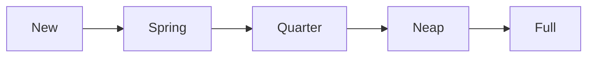

# The booklet format, v0.13.0

**A booklet is one Markdown file that a person can read and edit in any text editor, that Obsidian shows as a normal note, and that the Booklet renderer, or a Booklet plugin inside Obsidian, turns into activities with questions, widgets and reading.** The prose is the document. Booklet's own elements are single callout lines. Data, and anything a reader answers, lives in fenced blocks. Before anyone has answered, the only JSON in a booklet is the data of its widgets and data blocks.

> **Status: v0.13, draft.** This format is young and will change. Nothing before v1.0 is stable, and
> nobody keeps older files working. This spec, the renderer, the skill, the tests and the file marker
> are all v0.13. Section 2 says how the marker works.
>
> **This document may describe things the reference renderer does not do yet.** Each one is marked where
> it is described, in the words "The reference renderer does not do this yet", and all of them are
> listed in section 13.

**Why it looks like this, in short.** A booklet's design is Markdown, so a person can edit it by hand. It uses constructs that already exist and already render somewhere real: GitHub's task lists and callouts, Obsidian's callouts and block embeds, CommonMark's footnotes. What Booklet needs and no existing convention supplies (a question's kind, a module's boundary) is one small vocabulary of callout lines, `> [!kind|id] Title`. There is one new grammar to learn. [`docs/why-markdown.md`](docs/why-markdown.md) says what was surveyed and why each choice was made.

---

**Contents**
1. [What a booklet is made of](#1-what-a-booklet-is-made-of)
2. [The file: name and front matter](#2-the-file-name-and-front-matter)
3. [Structure: activities and pages, with every heading left free](#3-structure-activities-and-pages-with-every-heading-left-free)
4. [Booklet lines: one grammar for everything](#4-booklet-lines-one-grammar-for-everything)
5. [Questions](#5-questions)
6. [Reading: callouts, hints, citations, images and figures](#6-reading-callouts-hints-citations-images-and-figures)
7. [Widgets and other data](#7-widgets-and-other-data)
8. [Records: what a reader answered](#8-records-what-a-reader-answered)
9. [Languages](#9-languages)
10. [Obsidian and GitHub: what to expect](#10-obsidian-and-github-what-to-expect)
11. [A complete booklet](#11-a-complete-booklet)
12. [Conformance](#12-conformance)
13. [What's not built yet](#13-whats-not-built-yet)

---

## 1. What a booklet is made of

Four things, and nothing else:

- **Front matter**: a few flat keys at the top, the way Obsidian, Hugo and Jekyll write them.
- **Prose**: ordinary Markdown. Headings at every level, paragraphs, lists, emphasis, links, tables, footnotes, `$math$`, and fenced code, all free for writing.
- **Booklet lines**: a callout line, `> [!kind|id] Title`, marks anything Booklet needs to know about: an activity, a question, a widget, a menu.
- **Fences**: data and records in fenced code blocks, by convention at the end of the file. No code in the prose; data below, referenced from above.

The rule that decides every detail below: **a booklet is answerable only in Booklet's renderer or a Booklet plugin, so everywhere else it only has to read well.** Simple and clean to write; breaks nothing in Obsidian; breaks nothing too badly on GitHub.

---

## 2. The file: name and front matter

**Name.** `<slug>.booklet.md`, and for a translation `<slug>.<lang>.booklet.md`, for example `tides.booklet.md` and `tides.es.booklet.md`. Obsidian shows the note as `tides.booklet`, which is fine. A reader decides what a file is from its contents, never its name.

**Front matter.** Flat keys only, because Obsidian's Properties editor treats nested values as second-class and may rewrite the block when a property is edited. A renderer must accept any key order and any quoting.

```yaml
---
booklet: "0.13"
id: example/tides
title: How tides work
lang: en
version: "0.1"
copyright: Example Press, 2026
license: CC-BY-4.0
---
```

- `booklet` is the format version the file uses: `0.13` for this document. The marker rule is below.
- `id` names this booklet across its translations and versions.
- `lang` is the language of the page around the content: the renderer's own words and defaults. In a module's own file it is also the language the module is written in (section 9).
- **The front matter's `id` is the booklet's own name, not an id in the sense of section 4.** It may hold slashes (`example/tides`), and it is not one of the ids a question, an activity or a module carries, so the rule for those (letters, digits and dashes, unique in the file) does not apply to it.
- `title` is the booklet's own name: the one name its home screen, its row in a list of booklets and the name of the file a renderer saves all show. A module file's own `title` names the module and never the booklet, so adding a module leaves the booklet's name alone. A renderer may let a reader rename the booklet, which rewrites this one line, with the new name as a quoted string.
- **The marker is written in quotes: `booklet: "0.13"`.** Unquoted, a YAML reader (Obsidian's properties panel, GitHub) takes `0.10` for the number 0.1 and may write it back that way, so the linter warns on any unquoted marker whose minor ends in 0.
  - A reader reads the marker as text and compares versions as two whole numbers, major and minor, so 0.10 is later than 0.9. `booklet: 0.13`, `"0.13"` and `'0.13'` are all this format. `booklet: 0.1` is the earlier version 0.1, not 0.10.
  - A tool that writes booklets writes the current marker. `lint-booklet.py --marker` prints the line.
  - A reader never changes a file's marker. It saves a file back with the marker the file came with, and a booklet it makes itself says `"0.13"`.
- **Another marker.** A file with no marker, or one that is not a `0.x` version (`1.0`, `2`, words), is not a booklet for this version. A file marked with another `0.x` version, earlier or later, is opened by this version's rules.
  - A reader says so first among the file's problems: "This file says booklet: 0.9. This page reads format 0.13 and has opened it as it is; some of it may not draw."
  - It makes no promise about what such a file draws. What its rules do not understand is reported like any other problem.
  - A rule that refuses a file (a module opened and not closed, an id used twice in a module) refuses it whatever the marker.
  - A module file with another `0.x` marker may be added to a booklet, with the same notice.
  - A third number (v0.13.1) is a patch to this wording or to the renderer. It changes no file, and files go on saying `"0.13"`.
- `start` is optional and has one value, `start: home`. Any other value is an error in the linter, and a renderer reports it and ignores it.
  - Without `start`, a booklet that holds exactly one activity opens straight into that activity. A booklet that holds exactly one module, with several activities, opens on that module's own screen. Any other booklet opens on its home screen.
  - `start: home` keeps the home screen. Use it for a booklet still being built, or one whose home screen says something a reader should see first.
  - The back control from the activity or module leads to the home screen either way.
- `copyright`, `license` and `source` live in front matter — the file is the unit that travels (section 3), so the front matter travels with it. In a file that holds one module and no notice callout, they are that module's notice (section 3). `version` is the file's own and is never a module's notice.
- Reserved by Obsidian and therefore never used for anything else: `tags`, `aliases`, `cssclasses`.
- **Any other key is kept as written and ignored.** A reader that does not know a key neither reports it nor drops it: it is still there when the file is saved.

---

## 3. Structure: activities and pages, with every heading left free

**Headings never decide modules, activities, pages or answers.** Every heading level is free for prose. Structure comes from lines Booklet adds, never from heading depth. A reader does read a heading in three ways: it names a page, it starts a cell in a row, and a heading link can open it.

**A booklet is a collection of modules, and it is natively one file.** A module is the unit that travels whole, and the unit inside which activities may refer to each other: a weekly report that reads the week's entries, or a dashboard that draws itself, only works if the activities it reads are guaranteed to arrive together, and the module is that guarantee. A renderer handed a folder assembles one file from it (below).

**A module is fenced: an opening line and a closing line, both required.**

```markdown
> [!module|week-1] Week 1

> [!activity|w1-words] Words

…

> [!module|week-1 end] End of Week 1
```

- A linter and a renderer refuse a file whose module is opened and not closed, closed and not opened, or whose fences overlap. Modules bleeding into each other is the failure this rule prevents.
- Within a module, an activity may read another's answers and entries by id. Across modules it may not: the linter reports a reference that crosses a module boundary (a query's `from:`, a `menu:`, an embed) as an error, and a renderer draws nothing for it and lists it with the file's other problems. The file still opens.
- **Bare activities and modules may share a file.** A bare activity sits outside any module fence, by convention before the first one. Bare activities together are one module with no name (section 4): they may read one another's answers and entries, `parent:` places them as it does inside a module, and their records sit under the plain `> [!records]` line. A bare activity may have the id of a module. A file with no module fence is bare activities only: a worksheet needs no more.
- A module id is used once in a file, and stays unique across a person's collection; adding a module whose id is already present replaces it. Any other id a module uses is its own (section 4).
- **A module's opening.** Prose inside a module's fence before its first activity, other than its notice, is the module's opening: a renderer shows it on the module's own screen, above the module's activities, and nowhere else. A module with none opens on its title and its activities.
- **The booklet's opening.** Prose, and reading callouts, before the file's first module or activity line are the booklet's opening: a renderer shows them on the booklet's own home screen, under its title, the way a module's opening is shown on the module's screen (the first paragraph larger, the rest under it), and nowhere else. A booklet with none opens on its title and its cards. A leading heading that repeats the title above it (a `# Title` line, compared by its words without their marks) is drawn once, as the title. A file with no module and no activity line is one activity, and its prose is that activity's, so it has no opening. The same holds for a module: its opening does not repeat the module's title. Notes for whoever edits the file go in an HTML comment (`<!-- … -->`), which is never drawn. A question line before the file's first module or activity line belongs to no activity: a renderer reports it and draws it nowhere, and the linter reports an error. **The reference renderer does not do this yet:** a footnote mark (`[^id]`) in the booklet's opening has no sources to number it, so it is left out.

**Where data goes.** The blocks a module's activities refer to (widgets, figures, menus, image definitions, data blocks) sit in one of three places:

- **Inside the module's fence.** The block is that module's, and no other module can use it.
- **Under a `> [!data|week-1] Data for Week 1` line**, in a data section at the end of the file. The line belongs to the module whose id it carries, the way a records line does. A block under it is that module's too, as if it sat inside the fence, until the next `data`, `module` or `activity` line.
- **Under a plain `> [!data] Data` line**, at the end of the file. The block is shared: any module can use it.

A reference is looked up in the module's own fence, then the module's own data section, then the shared data section. It is never looked up in another module's fence or data section (section 4).

- A file may have several data sections. A data line takes an optional module id and no settings.
- A file that holds one module may keep all its data under a plain `> [!data]` line. Those blocks are that module's when the module is added to a booklet, and inside the file they are found either way.
- A tool that adds a module to a booklet puts the data it brings under the module's own `> [!data|module-id]` line. An update of the module replaces exactly its fence and that section.

### A module's notice

A module may state its terms where they travel with it, in a `notice` callout inside its fence:

```markdown
> [!module|check-in] A daily check-in

> [!notice]
> license: Free to copy and share, unmodified and with this notice intact.
> copyright: Example Press, 2026
> source: https://example.org/check-in
> version: 1.2

> [!activity|check-in-log repeat] Check in
```

- Each line is `key: value`, and the keys are `license`, `copyright`, `source` and `version`; any may be left out, and anything else in it is a linter error. A notice takes no id and no settings. A module has at most one, and it sits inside the module's fence before the module's first activity. A notice outside a module's fence, or after its first activity, is an error in the linter. A renderer ignores it and reports it. A notice's `version` is the module's, and need not look like the booklet's.
- **A file that holds one module and no notice callout is covered:** its front matter's `license`, `copyright` and `source` are that module's notice, so nobody has to rewrite a module file; either form may be used, and when both are present the callout wins. The front matter's `version` is the file's own and is never a module's notice: a module's own version is written in its notice callout.
- A tool that adds a module whose notice is only in its file's front matter writes it into the module's fence as a `> [!notice]` callout, so the notice is in the booklet's own file, and an update replaces it with the module's. A renderer keeps the callout exactly as written.
- A renderer shows a module's notice as a quiet disclosure, closed until opened, headed "About this module": the licence, the copyright, the source (a link only when it is an `http://` or `https://` address, otherwise plain text) and the version, on the module's own page and at the foot of a module that is one activity. A module with no notice shows nothing. Every value is text.

**Answers never travel inside a module.** A module used for months would drag hundreds of lines of JSON with it. Records sit in the records section at the end, opened by `> [!records] App record`, and grouped by module under `> [!records|week-1] Week 1`, so the right JSON is one search away. **The module id on a records line is what ties the record blocks under it to that module**, until the next records line: its `answers` are that module's, and the activity named on an `entries` or `draft` block is that module's activity. Record blocks under the plain `> [!records]` line, with no module line before them, belong to the bare activities, which are one module with no name; a records line that names a bare activity (`> [!records|inbox]`) is read the same when no module has that id. To take a module and its answers somewhere else, copy two sections.

**A booklet's parts in other files, and a manifest that lists them, are a draft** (section 13, "Drafts"). Nothing in this document depends on them: a booklet is one file.

**A link to a whole module.** `[[week-2.booklet]]` or `[Week 2](week-2.booklet.md)` in prose names the module `week-2`: the file's name before `.booklet`, which is the module's id. Such a link is for a module that may not be in this booklet, one in a registry or one the reader has not been given yet: a renderer opens the module if the booklet holds it, and otherwise shows the link as a module that is not here, asking the network for nothing until the reader acts. To move within a file, link to a heading (below).

**Navigating the file in an editor.** Every part opens with a line of one shape, so searching for `[!module|`, `[!activity|`, `[!data` or `[!records` walks the file.

**An activity starts at an activity line and runs to the next one.** A file with no activity line is one activity, named by the front matter title. So a one-page worksheet needs no structure at all.

```markdown
> [!activity|rd-tides] Why the sea rises twice a day

Prose, headings, questions…

> [!activity|rd-check repeat] Check yourself

…
```

The words after the id are the activity's **settings**:

| setting | what it means |
| --- | --- |
| *(none)* | answered once, edited in place |
| `repeat` | each completion is kept as a dated entry, with a history |
| `repeat daily` | one kept entry per day; completing again replaces today's |

`hidden` may follow either (kept in the file, not offered). `daily` needs `repeat`.

**An activity may sit under another.** `parent:<id>` names the activity it belongs under, in the same module:

```markdown
> [!activity|booklet-dev] Booklet (dev)

> [!activity|v1-0-release parent:booklet-dev] Booklet v1.0: the stable format
```

It means what `parent` means on a list row (section 6): an activity whose parent is not in its module (or, for a bare activity, not among the bare activities) sits at the top, and the linter warns; one that is its own ancestor is drawn once, at the top; when two activities share an id, the first is used. Activities under the same parent keep the file's order, and moving on from an activity goes to its first child, then its next sibling, then back up: the order of a file written parent first. A module whose activities carry no `parent` is a flat list. `parent` places an activity; it does not let one read another's answers.

**A card's picture.** A renderer that draws modules, activities and sections as cards gives each a picture, chosen the same way everywhere. It uses the line's `icon:` if it has one. Otherwise it uses an emoji at the start of the title, which is then not repeated in the title. Otherwise it uses the card's number in its list. `icon:` takes a name from Booklet's icon set, the Lucide 1.48 icons listed in the booklet repository's `art/icons/` (lucide.dev): `icon:compass`, `icon:notebook-pen`. The set may grow in a later version. A name outside it is reported and ignored, like a mistyped setting. Sections and callouts take no settings, so a leading emoji is how they choose a picture. A renderer may draw the picture as that icon or as an illustration of the same name; that is its look, not the file's.

**Pages are separated by a horizontal rule.** Any thematic break inside an activity (`---`, `***`, `___`) is a page break, the way Marp splits slides. A page's name in the left menu is its first heading, at whatever level; a page with no heading is "Page 2". An activity with no rule is one page.

⚠️ `---` needs a blank line above it, or Markdown turns the line before it into a heading and the page break vanishes. `***` has no such trap. Both are accepted.

**Links between activities** are ordinary heading links, which Obsidian resolves natively: `[[#Check yourself]]` or `[Check yourself](#check-yourself)`. A link opens the first place in the link's own module whose heading or title reads those words: a heading, an activity's title, a page's name, a question's prompt or a callout's title. It is **looked for in the link's own module** (the bare activities together are one module), never in another module's fence; a link whose words only another module has is shown as plain text, like a link to words that are nowhere, and the linter warns. Reading another activity's *answers* is a module matter, above.

### Rows: things side by side

A row asks for what is inside it to be laid side by side when there is room.

```markdown
> [!row]

### Overdue

```booklet query
from: overdue
```

### Due soon

```booklet query
from: due-soon
```

> [!row|end]
```

- A row opens with `> [!row]` and closes with `> [!row|end]`: the word after the bar is a setting, as `end` is on a module's closing line.
- **Each heading at the shallowest level inside the row starts a cell.** Anything before the first heading is a cell of its own. With no headings at all, each block is a cell.
- A renderer decides how many cells fit across, and puts them one under another, in file order, on a narrow screen. A file never states widths, columns or breakpoints.
- Anything may go in a cell: prose, questions, widgets, queries, figures.
- Rows do not nest, and a row does not cross a page break, an activity line or a module fence.
- In an editor, on GitHub and in Obsidian a row reads top to bottom, with its two marker lines showing as small callouts.

---

## 4. Booklet lines: one grammar for everything

```markdown
> [!kind|id setting:value flag] Title
```

- **`kind`** says what the line is: an activity, a question kind, a widget, a menu, a row, or a reading callout. Kinds are Booklet's own vocabulary, and the set is meant to grow (section 5). A kind is written with the same characters as an id (letters, digits and dashes), so `> [!2col]` is a callout; a `> [!` line whose kind has any other character, such as `> [!my_kind]` or `> [!café]`, is not a Booklet line, and a renderer reports it and leaves it as text.
- **A module's end line repeats its module's id** (`> [!module|week-1 end]`): the id is the first word, as on any line, and `end` is a setting. `> [!module|end]` opens a module whose id is `end`.
- **`id`** is required for anything that stores an answer or is referenced (activities, questions, widgets, menus). Letters, digits and dashes only, so every id is also valid wherever Obsidian wants one. Unique within its module (below). Reading callouts need none, and neither does a row (`> [!row]` … `> [!row|end]`, section 3), which is structure like a page break. An activity or module line with none is an error in the linter, and a renderer reports it and names the activity from its title (a module by its place in the file), which a later rename of the title would change.
- **The first word after the bar is the id, for every kind that takes one, and every later word is a setting.** No id is reserved: an activity may be called `repeat`, `long`, `end` or `home`. **Kinds that take no id** are `row`, `notice`, `manifest`, `hint`, `solution` and Booklet's own reading kinds `group`, `diff`, `law` and `opinion`; all their words are settings, so `> [!row|end]` closes a row, and a word after the bar on a `hint` is a setting it does not take.
- **Settings** follow the id, separated by spaces: `menu:places`, `min:0`, `open`, `repeat`. A setting written before the id is read as the id, and the id after it is reported as a setting the kind does not take.
- **The title** is the words a reader sees: the question, the activity name, the caption. **Every word on or under a booklet line that a reader sees is inline Markdown**, as the prose around it is: a title, a question's help text, an option, an option's reply, a scale's anchor, a matrix's item, a menu's entry. Emphasis, code, links and `$math$` are drawn wherever those words appear (the question, a card, a breadcrumb, a page's head, a menu, the stepper, a kept entry), so `> [!choice|bigger] Which is bigger, $\frac{2}{3}$ or $\frac{3}{5}$?` draws its formulas. A button, or a card that opens something, holds no link: there a link is drawn as its words. Elsewhere a heading link (`[[#Heading]]`, `[t](#heading)`) works as it does in prose, and is never drawn with its `#`. A display formula (`$$…$$`) in a title is drawn inline, and a footnote mark in one is left out. Where bare words are needed, the words are used without their marks: a page menu's text, a label a screen reader speaks, the document's title, and the check that a reader's own option equals a listed one (section 5). Data values (section 7) are plain text, never read this way. A dollar sign written for a price is written `\$5` (section 10), in a title as in prose.
- **A fold marker** may follow the bracket, as in Obsidian: `> [!hint]- Hint` starts folded.

**An id belongs to its module.**

- An id is unique within its module: activity ids, question ids, widget-line ids, menu ids, block ids (`^id`) and footnote ids. Two modules in one file may use the same id for different things, and neither can see the other's. Module ids are unique within the file.
- Activities outside any module fence (bare activities) together count as one module with no name. Their ids are in one scope, the scope of a plain `> [!records]` line. That scope is not a module's, so a bare activity and a module may have the same id.
- A module's scope is its fence and its data section (`> [!data|module-id]`, section 3). The plain data section at the end of the file (`> [!data] Data`) is shared: a block there (a widget, a figure, a data block, a menu) may be used by any module, and its ids are unique among the blocks in that section.
- **A reference is looked up in its own module first (its fence, then its data section), then in the shared data section, and never in another module's fence or data section.** That holds for an embed `![[#^id]]`, a `menu:id`, a query's `from:` and a footnote mark `[^id]`.
- What a reader answered is tied to its module by the module id on a records line (section 8), so the same question id in two modules holds two answers.

**What comes after the line.**
- A **list** belongs to the line (a question's options, a menu's entries). It may follow directly or after one blank line; two blank lines end the question. **One exception, from Markdown itself:** only a numbered list that starts at `1.` may interrupt a paragraph, so a list starting at `0.` (or any other number) directly under the line is swallowed into the title. Put the blank line in; the reference linter requires it there and allows it everywhere else.
- **Lines starting with `>`** directly under a booklet line belong to it. Under a reading callout they are its prose. Under a **question** line they are its **help text**: a renderer shows them under the prompt. A question's prompt is its title. A `> [!hint]-` callout after a question is a different thing: a hint the reader opens (section 6).
- **A paragraph** after the line needs a blank line first, like any paragraph. Without one, Markdown folds it into the callout (a "lazy continuation").
- A **hint** or **solution** callout right after a question belongs to that question (section 6).

**What each kind takes.** Settings are the flags and the `key:value` words after the id. Each kind takes only the settings in this table, because a mistyped setting (`mx:5` for `max:5`) would otherwise vanish without a word. A setting a kind does not take is an error in the linter, and a renderer ignores it and reports it. `daily` needs `repeat`. The values of `min:`, `max:` and `step:` are numbers.

| kind | settings it takes |
| --- | --- |
| `module` | `end`, `icon:` |
| `activity` | `repeat`, `repeat daily`, `hidden`, `icon:`, `parent:` |
| `row` | `end` |
| `text` | `long` |
| `lines`, `scale`, `matrix`, `date`, `menu`, `hint`, `solution`, `data`, `records`, `manifest`, `notice`, `group`, `diff`, `law`, `opinion` | none |
| `choice`, `multi` | `open`, `menu:<id>` |
| `number` | `min:`, `max:`, `step:` (numbers) |
| `widget` | `readonly`, `describe` |

`icon:` takes an icon name and `parent:` an activity id (section 3). Neither is written on a module's end line.

**Unknown kinds.** A line with an id or settings whose kind is not in this table is an **unknown kind**. A renderer draws it as a callout, with a quiet line under its title saying that it does not know the kind, and reports it; the linter warns. A line with no id and no settings is a reading callout of whatever kind its author chose (`note`, `tip`, Booklet's `diff`, and so on, section 6), drawn with no notice. `group`, `diff`, `law` and `opinion`, Booklet's own reading kinds (section 6), are in the table above and take no settings. A line that starts `> [!` but cannot be read as a Booklet line is reported, and is read as text.

**Case.** Kinds, settings, query keys and `as:` are read without regard to case. Ids and values (theme values, tone names, and the words a person wrote) are exactly as written.

In Obsidian, an unknown kind renders as a note-style callout with the title, so every Booklet line is a visible, titled box there. The `|id` part is callout metadata, which Obsidian parses into `data-callout-metadata` for themes to style; it is not documented in Obsidian's own help, but it renders correctly.

---

## 5. Questions

**Principle: declare the kind on the question line; put plain lists under it. Nothing else.**

### Text and lines

```markdown
> [!text|noticed] What surprised you?

> [!text|reflection long] Write freely about the week.

> [!lines|wins] Three things that went well
```

`text` is a text answer; `long` asks for a bigger box. `lines` is repeated one-line entries.

### Choice: pick one, pick any

```markdown
> [!choice|biggest] When do the largest tides come?
- [ ] At the quarter moons
- [x] Near the new and the full moon

> [!multi|outside open] What did you do outside today? Add your own.
- [ ] Walked
- [ ] Gardened
- [ ] Sat in the sun
```

- `choice` takes one answer, `multi` any number. `open` lets the reader add options of their own.
- **The reader's own option.** With `open`, a field and an Add button sit under the options. An option the reader adds is stored in the answer as the words they wrote, a string, in the place a position would be: a `choice` holds the position or the string, a `multi` a list of positions and strings. Text equal to a listed option (ignoring case and spaces) presses that option instead; an own option is never added twice, and nothing is ever written into the file's list of options. A renderer should offer again, in an activity that keeps entries, the own options the reader added to that question in earlier kept entries, as ordinary unpressed options after the listed ones. A shared menu (`menu:id`) with `open` behaves the same.
- **`[x]` marks a correct option**, for study booklets. A worksheet with no right answer leaves every box `[ ]`. A renderer shows the reader whether they were right once they have answered: for a `choice`, as soon as they pick, the picked option is marked right or not, and the correct one is marked as the answer; for a `multi`, a Check button marks each option picked and right, picked and not right, or right and missed. Nothing is scored and nothing is stored: the answer is recorded as usual and the file never says whether it was right. An own option (`open`) is neither right nor wrong. A `choice` with more than one `[x]` has the first as its answer. **The correct option is visible to anyone who opens the file as text.** In Obsidian's Reading view, a click on a checkbox rewrites `[ ]` to `[x]` in the file — a real behavior, and the accepted trade-off: a booklet's own reader answers it in Booklet, never by clicking a checkbox in an Obsidian note, so the answer key is never at risk from ordinary use.
- **A reply for each option.** A bullet nested under an option is that option's **reply**. It is nested the way Markdown, and so Obsidian, nests it: written at least as far in as the option's own text starts (two spaces under `- [ ]`). A bullet indented less than that, one space for instance, is not a reply; it ends the option list.

  ```markdown
  > [!choice|where] Where are you right now?
  - [ ] Calm
    - That is the settling system at work.
  - [ ] Wound up
    - That is the activating, unpleasant family.
    - It is also useful.
  ```

  Each nested bullet is one line of the reply, so Wound up has a two-line reply here (a bullet nested deeper is one more line). A line that is no bullet, written deeper than the bullet above it, goes on with that line (they join with a space). Any other indented line ends the list. A blank line also ends the option list, between two options as between an option and its reply, and what follows is read as text: the linter warns.

  When the reader picks an option, its reply is shown under the options: for a `choice`, the picked option's; for a `multi`, each picked option's, in the options' order. Pick another and the reply changes; clear the pick and it goes. **A question that marks a correct answer (`[x]`) shows its replies with its marks:** a `choice` as soon as the reader picks, a `multi` once the reader has pressed Check. A reply would otherwise give the answer away. A reply is inline Markdown, like an option. It is **content, not an answer**: it is never stored, never sent, and never counted or shown as an option, so adding replies changes no answer and no position. An option with none shows none. An option's own text is its one line: a reply never joins it. Only the options of a `choice` or `multi` take replies; a nested bullet anywhere else is not a reply (the linter warns), and an option the reader adds with `open`, or one that comes from a shared menu, has none. `[x]` marks and a following `[!solution]-` work as before. In Obsidian and on GitHub a reply is a sub-bullet under its option, which is intended.
- **Options are identified by position, not by id.** The third option is the third option in every language file too, so a whole list carries one id. This is what removes per-item tags. A file that reorders options after people have answered breaks its own answers.

### Scale, number, date

```markdown
> [!scale|clarity] How clear was the reading?

0. Not clear
1. A little clear
2. Fairly clear
3. Clear
4. Very clear

> [!number|sleep min:0 max:24] Hours slept

> [!date|when] When did it happen?
```

A `scale` lists its anchors as a numbered list; **the number is the stored answer**, so a scale that starts at 0 is written from `0.`, with a blank line above it (section 4).

### Matrix: items and anchors

A matrix question is several items answered on one shared scale of anchors. It is written as a bulleted list of items, then a numbered list of anchors. It is deliberately not a table, so one stray space never breaks it:

```markdown
> [!matrix|topics] How sure are you of each topic?

- Spring tides
- Neap tides
- Tidal range

0. Not yet
1. Getting there
2. Sure
```

A blank line may separate the two lists (section 4), and the numbered list needs one above it when it starts at `0.`. The reader chooses one anchor per item. **The answer is stored as a list with one anchor number per item, by position** (`[1, 3]`; `null` for an item not yet answered), under the question's id. Like a `scale`'s, the number is the stored answer, so the anchors' own numbers are what is kept.

**How a question is drawn is the renderer's business, and it follows one rule.** A question's words keep a readable width, and its options sit beside them only when both fit, else under them. Which options may sit beside: those of a `choice`, `multi` or `scale` that are at most four, each at most 24 characters, on a question without `open`; any other list is always drawn under the words. A matrix is the same rule for a whole set of items, and it gets the content column's full width, as a table does: where each item's words, at a readable width (smaller than a single question's, since the anchors are shared), and the row of anchors fit side by side, the matrix is drawn as a grid of rows; where they do not (a phone), each item is drawn as a single-choice question of its own, with the anchors as its options, and the matrix's own words become the stem above them. This changes the drawing and nothing else. The stored answer is the same list under the same key either way, so a window that is made narrower and wider again loses no answer. A reader who sees the items as separate questions may clear one by pressing its answer again, which stores `null` for that item, as an item not yet answered.

### Shared menus

A list used by several questions is written once, in the module whose questions use it (or in the data section, for every module to use), and named on the question line:

```markdown
> [!menu|places]
- Park
- Garden
- Library

> [!multi|morning menu:places] This morning I went to…

> [!multi|evening menu:places] This evening I went to…
```

### Widgets as questions

A widget the reader operates (the body map, a grid of cells) is a `widget` line whose body embeds the widget's data block (section 7). What the engine records is stored under the widget's id.

### The kinds, in one table

| kind | answer stored | under the line |
| --- | --- | --- |
| `text` | a string | nothing (`long` for a big box) |
| `lines` | a list of strings | nothing |
| `choice` | the option's position, from 1; with `open`, or the reader's own string | a task list; `[x]` = correct; a nested bullet = that option's reply |
| `multi` | a list of positions, plus the reader's own strings with `open` | a task list; `[x]` = correct; a nested bullet = that option's reply |
| `scale` | the anchor's number | a numbered list |
| `number` | a number | nothing; `min:` `max:` `step:` |
| `date` | `YYYY-MM-DD` | nothing |
| `matrix` | one anchor number per item, by position | a bulleted list, then a numbered list |
| `widget` | whatever its engine records | an embed of the data block |

**How the vocabulary grows.** A new question kind is a new kind word, a documented shape for what follows the line, and an engine in the renderer. The grammar never changes. A renderer that meets a kind it doesn't know shows the line as a callout and what follows as lists, and says so, instead of failing (section 4, "Unknown kinds").

---

## 6. Reading: callouts, hints, citations, images and figures

### Callouts

Reading set apart is an Obsidian callout, with `>` on every line of its body. Use Obsidian's built-in kinds where they fit (`note`, `tip`, `example`, `quote`, `question`, `warning`), and Booklet's three for guided reading: `diff` (where this differs from the reader's own guide), `law` (the rule as it stands), `opinion` (an author's view, not to be learned as a rule). Booklet's fourth kind is `group`, the plain fold, for anything Markdown can hold, written `> [!group]- Title` to start folded. All four take no id and no settings.

A renderer draws each kind in its own colour and picture. A kind the format does not define, written with an id or settings, is reported (section 4). The four kinds above are defined, so they never are.

```markdown
> [!diff] Your guide says the tide turns every six hours
> The guide rounds it off. High water comes a little later each day.[^atlas-12]

> [!group]- Background, if you want it
> Folded until opened. Anything Markdown can hold goes inside.
```

### Hints and solutions

A `hint` or `solution` callout directly after a question belongs to it. A hint helps before the reader answers. A solution explains after. Fold both with `-`.

```markdown
> [!choice|biggest] When do the largest tides come?
- [ ] At the quarter moons
- [x] Near the new and the full moon

> [!hint]- Hint
> Think about when the sun and the moon pull in the same direction.

> [!solution]- Solution
> At the new and the full moon the sun and the moon line up, so their pulls add together.
```

### Citations

A citation is an ordinary CommonMark footnote — the mark `[^id]` in the text, and its definition, `[^id]: …`, anywhere in the file. There is no separate sources registry: a source cited at two places is two footnotes.

```markdown
Most harbours see two high tides each lunar day.[^atlas-12]

[^atlas-12]: *The Harbour Tide Atlas*, 2nd edition (2019), p. 12: "The tide rises and falls twice in each lunar day." Verified 2026-09-20.
```

**A footnote's note, read into a citation.** The reference renderer reads a definition's text and, where it fits the pattern `*Title*, details, p. N: "quote" Verified YYYY-MM-DD.`, turns it into a source and a citation — title, edition, page, quote, and verified badge. This gives a reading module a numbered mark, side panel, hover preview and verified badge, with no separate registry to maintain. A note that doesn't fit the pattern is a plain reference: the panel shows its words as they were written, with no source, no quotation marks and no check, rather than failing or complaining that a source is missing. The pattern, piece by piece:

| piece | example | required? |
| --- | --- | --- |
| the source's title | `*The Harbour Tide Atlas*` (italic) | for a source to be shown at all |
| its edition or other detail | `2nd edition (2019)` | optional |
| the page or place | `p. 12`, `pp. 12–14`, `art. 14` | optional |
| the quote, in quotation marks | `"The tide rises and falls twice…"` | required for any citation |
| a verified date | `Verified 2026-09-20.` | optional; shows the ✓ badge |

A footnote is one paragraph: its first line and any indented lines straight after it.

**The definition line itself never shows.** It is stripped from the document's own prose at the point the file is read, so it is never rendered as a stray paragraph — the citation lives only in the numbered mark and its panel.

### Images

Reference style, with the address at the end of the file among the data, so the prose stays clean. GitHub and Obsidian both resolve it and hide the definition line.

```markdown
![The harbour at low water][harbour]

[harbour]: images/harbour.jpg
```

Images are linked, never embedded. A Booklet renderer fetches an image only from a place its own host declares, never from an address the file names directly. A remote address (`https:`, `http:`, or one that starts `//`) is never requested; a relative path (`images/harbour.jpg`) is looked up only in a store its host declares; an address with any other scheme (`data:`, `javascript:`, `file:`) is never used. Showing an image from a declared store is what a renderer with a host can do. (The reference renderer does not do this yet; see section 13.) Where a renderer does not show an image, it shows the alt text and the address as text, so a reader can see what was meant. The linter warns on an image with a remote address (`http:`, `https:` or `//`) and reports an error for any other scheme; a relative path is fine.

### Figures: diagrams placed by reference

A diagram is written once, in the data section, with an Obsidian block id on the line after its fence, and placed in the prose with Obsidian's own embed:

```markdown
Here is the cycle:

![[#^tide-cycle]]

…


^tide-cycle
```

Obsidian draws the diagram natively at the embed. On GitHub the embed line shows as text and the diagram renders where the fence itself sits. A mermaid fence written directly in the prose works everywhere.

**A diagram that could make a renderer ask for an address is not drawn.** A renderer must not let a diagram library request an address a diagram's source names, and may refuse to draw such a diagram, showing its source instead.


### Queries: showing kept entries and data

A `booklet query` block, placed in an activity's prose, shows what the reader has kept elsewhere in the same module, or the rows of a data block (section 7). It is read-only and takes no answer.

```booklet query
from: log
fields: situation, ease
limit: 3
empty: Nothing logged yet.
```

- `from:` (required) is an activity id or a question id in the same module. An activity must keep entries (`repeat` or `repeat daily`); the query shows its kept entries, newest first, each with its date and answers. A question shows that question's answers: each kept answer with its date if its activity keeps entries, or its one answer if not.
- `fields:` (optional, with an activity) names the questions to show, comma-separated, in that order. Without it, every question is shown.
- `limit:` (optional) shows only that many of the most recent entries.
- `empty:` (optional) is what shows while nothing is kept. Without it, the renderer shows its own short line.
- It reads kept entries and given answers only, never a draft in progress.
- A query never reads across modules. One whose `from:` names nothing, or something in another module, cannot be drawn: the linter reports an error, and a renderer draws nothing for it and reports it. The file still opens. The activities outside any module fence are one module for this rule.
- The kind, `query`, is on the fence line; the settings are the block's lines, `key: value`. Ids follow the rule in section 4 (letters, digits and dashes).
- In Obsidian without a Booklet plugin, and on GitHub, the block shows as a short code block.

A query can also draw a data block, and can say how.

```booklet query
from: short-list
as: list
group: why
```

- `from:` may name a data block (section 7) in the same module or in the file's data section.
- `as:` chooses the view. `cards` is the default for kept entries; `table` is the default for a data block. Every view draws every source.

**Roles.** A view draws a row from the parts its fields play. There are seven, and each is read from the field of the same name unless the query names another.

| role | what it is | read from |
| --- | --- | --- |
| `label` | the row's name | the field `label`, or else the first field |
| `value` | its main figure | the field `value` |
| `note` | a quieter second line | the field `note` |
| `badge` | a short word, drawn as a pill | the field `badge` |
| `tone` | `good`, `warn` or `bad` | the field `tone` |
| `link` | where the row leads | the field `link` |
| `icon` | the row's picture | the field `icon` |

So rows whose fields are already called `label`, `value` and so on need only `from:` and `as:`. A line such as `label: bucket` points a role at a field with another name. A role no row carries is simply not drawn.

**Tone.** A view's `tone` is `good`, `warn` or `bad`, exactly as written. A theme's `good`, `warn` and `bad` keys (section 7) set those same three colours, which a widget names `green`, `amber` and `warm` (section 7). A widget may also use the colour names `slate` and `teal`, which have no tone.

**Link and icon.** A `link` value is a link target written as prose writes one: `#Heading`, `week-2.booklet.md` or a web address. A view makes the row's label lead there, and a target it cannot follow is plain text. An `icon` value is an icon name (section 3); a name that is not one is not drawn. Both stay plain text in the data: a target is followed, never read as Markdown.

| `as:` | draws | reads |
| --- | --- | --- |
| `cards` | one card per row: a kept entry is a dated card; a data block's row is a card led by its label, its other fields as lines | `label`, `value`, `note`, `badge`, `tone`, `fields`, `group`, `limit`, `link`, `icon` |
| `table` | one row per row, one column per field | `fields`, `group`, `limit`, `badge`, `tone`, `link`, `icon` |
| `list` | one line per row: badge, label, the other fields, value; the note beneath | `label`, `value`, `note`, `badge`, `tone`, `fields`, `group`, `limit`, `parent`, `link`, `icon` |
| `tiles` | one tile per row: a big value over a label | `label`, `value`, `note`, `tone`, `group`, `limit`, `link`, `icon` |
| `bars` | one bar per row: a label and a length | `label`, `value`, `tone`, `limit` |
| `line` | one line per field, across the rows in order | `label`, `value`, `fields`, `limit` |

- `fields:` **picks** among the fields the rows have, and names the **other fields to show**, in order: a table's columns, a list row's quieter extras, a line chart's lines, a card's questions. (A data block's own `fields`, section 7, **declares** them: each key, its label and their order.) Without `fields:` a table shows every field, a list shows every field that plays no role, and a line draws the `value`.
- A table shows the fields its data block declares, or else the keys of the first row. A list's extras, without `fields:`, never include the `id` field, the `group` field or the `parent` field.
- `label:` falls back to the first field only when the query gives no `label:` at all. A `label:` that names a field no row carries draws no label (the linter warns).
- `group:` names a field; rows that share its value are drawn together under that value, in the order the values first appear, with a count.
- `limit:` is a positive whole number (anything else is ignored and reported). It draws only the first rows, that many, and it is applied before grouping and before anything the reader filters. For kept entries those are the newest.
- `from:` naming a single question makes that question the value.
- With `fields:` on kept entries, an entry that answers none of the named questions is not shown.
- `parent:` names the field that holds the `id` of the row this row sits under. A list whose rows carry it is drawn nested: each row under its parent, opened and closed by the reader. The default field is `parent`, so rows with `id` and `parent` fields nest with no key at all. A row whose parent is not among the rows is drawn at the top. A row that is its own ancestor (a cycle) is drawn once, at the top. When two rows share an `id`, the first is used. `limit` counts top-level rows; `group` is not drawn on a nested list.
- A `tone` of `good`, `warn` or `bad` colours the row's badge, or its value when it has no badge; a tile; a bar. Anything else is plain. A table's `tone` colours its badge column; a table with no badge column ignores `tone`. Tone is always also said in words to a screen reader.
- A `badge` that is a list is drawn as several pills.
- **Tiles with no value are pills.** When no row has a value, there is no big figure to draw, and each tile is a short pill holding its label: a strip of them reads as a status line.
- Every view also works on kept entries (`from:` an activity): each kept entry is a row, its questions are the fields, and its date is the field `date`. Over a data block, `cards` draws one card per row and reads the roles as every other view does: the `label` is its title (and where the row's `link` leads), the `note` the line under it, the `badge` pills, the `value` its figure, the `tone` its colour, the `icon` its picture, and every field that plays no role is a line under it, named by its label, as on a kept entry's card (`fields:` picks them and their order; the `id` and group fields are never lines). `group:` draws the cards under group headings. Over kept entries a card is titled by its date and its lines are the questions: of the roles, kept-entry cards draw `link` and `icon`, and the view takes `fields`, `limit` and `group`. **The reference renderer does not do this yet:** `label`, `value`, `note`, `badge` and `tone` on kept-entry cards are not drawn (the linter warns; `list` and `table` draw them).
- Values are plain text: nothing in a data block is read as Markdown or HTML.
- A query that sets a key its view does not read is not an error; the linter says so.

```booklet query
from: by-bucket
as: bars
label: bucket
value: count
```

```booklet query
from: sleep-log
as: line
fields: hours
```

- **Bars.** Each row is one bar: its label names it and its value is its length. Bars are drawn across the page, one under another, in row order, and always start at zero.
- **Line.** The rows, in order, are the points from left to right, and the label is written along the bottom. `fields:` names one or more number fields, each drawn as its own line and named by its field label; without it the value is drawn.
- A value that is not a number draws nothing: no bar, and a gap in a line.
- A chart always offers the same numbers as a table, so nothing is shown only as a picture.
- On kept entries a `number` or `scale` question is a number field, and the label is the entry's date. A reader's own answers over time are a line.
- A renderer chooses the scale, the ticks and the size, and fits the chart to the space it has, including inside a row.

**Sorting and filtering are the reader's.** A renderer may let the reader sort and filter the rows of any view on screen, and should offer the same control on every view. A renderer may offer it only on longer views, and a line chart keeps its order. It is saved nowhere, and a file never states it: a page always opens in the order its rows were written.

A query that names a data block in another module, or an `as:` that is not one of the six views, is not drawn, and is reported, like any other query that cannot be drawn. A query key this section does not list is ignored, and a renderer reports it; the linter reports an error.

**Design rules for views.** These bind anyone extending the format.

1. A view is a way to draw rows. It reads the shared roles and takes no key of its own.
2. A new role must mean the same thing in every view that draws it, and two real pages must need it.
3. A look that styling, density, or the shaping of rows by whatever wrote the file can give is never a new view or key.
4. A reader may open, close, sort and filter what is on screen, and none of it is saved. Anything that changes the file or sends something elsewhere is not a view's business.

---

## 7. Widgets and other data

**A widget is data, never code**. Its data is a fenced block named `booklet widget`, with a block id after it, and it is placed and operated through a `widget` line:

````markdown
> [!widget|body] Which muscles did you stretch?
> ![[#^body-map]]

```booklet widget
{ "engine": "svg-regions",
  "figures": [ { "id": "front", "svg": "<svg …>", "regions": ["head", "chest"] } ],
  "regions": [ { "id": "chest", "label": "Chest" } ] }
```
^body-map
````

- The fence holds JSON, as a data block's does. The widget's title is the title on the widget line, not a key in the data.
- `engine` names what draws it: `svg-regions` or `grid-select`. An engine a renderer does not have is shown as a notice, and the linter reports an error for one that does not exist. Labels are plain strings, because the file has one language.
- Settings on the widget line: `readonly` (shown, not operated) and `describe` (followed by what each part says about itself). Both engines honour both. A `grid-select` shows its items as plain words and `describe` adds each cell's `note`; an `svg-regions` shows its figure, with its regions named beneath it and nothing to point at or answer, and `describe` adds each region's `note`. Neither setting stores anything.
- **An `svg-regions` figure** marks each region the reader can tap as a shape with `class="rg"` and a `data-r` attribute naming the region id. Every other shape in the figure is drawn as a plain outline, and the renderer styles both; a figure needs no styling of its own.
- **Where it renders:** Booklet draws the widget. A Booklet plugin in Obsidian would draw it through the code-block handler for `booklet` — not yet built (section 13). Obsidian without the plugin shows the data block inside the embed frame, which is long but harmless. GitHub shows the embed line as text and the fence as code.
- Every `svg` string is sanitized before drawing.
- **Colours are colour names.** A colour in widget data is a **colour name**: `warm`, `green`, `amber`, `slate` or `teal`, exactly as written; anything else is no colour, and the linter reports it. The renderer draws the name in the active theme's colours, so a widget looks right in every theme. `green`, `amber` and `warm` are the colours the three tones `good`, `warn` and `bad` use (section 6); `slate` and `teal` have no tone. "Tone" means `good`, `warn` or `bad` and nothing else.

**What each engine reads.** The keys of a widget's data, and nothing else is read.

`svg-regions`: a figure with tappable regions, and words to say what it is like there. What it records is a list, one `{ "id": region, "s": [word ids, or the reader's own words] }` for each region the reader marked.

| key | what it holds |
| --- | --- |
| `figures` | the drawings: each `{ "id", "label", "svg", "regions": [region ids] }`; with more than one, a switch between them |
| `regions` | each tappable region: `{ "id", "label", "note" }`; `note` is shown with `describe` |
| `senses` | groups of words to say what it is like: `{ "id", "label", "words": [ { "id", "label" } ] }` |
| `chips` | region ids offered as buttons beside the figure |
| `copy` | the words the widget says: `h`, `p`, `stance`, `invite`, `pick`, `clear`, `none`, `sideLbl` |

`grid-select`: a grid of cells, each holding items to press and a field for a word of the reader's own. What it records is a list of item ids, and `x|cell|word` for a word of their own.

| key | what it holds |
| --- | --- |
| `cells` | the grid's cells: `{ "id", "label", "note", "color" }`; `color` is a colour name; `note` is shown with `describe` |
| `axes` | the four edge labels: `{ "top", "left", "right", "bottom" }` |
| `items` | what can be pressed: `{ "id", "cell": a cell id, "label" }` |
| `copy` | the words the widget says: `h`, `p`, `stance`, `invite` |

**Data blocks live inside their module's fence, in the module's own data section at the end (`> [!data|module-id]`), or in the shared data section (`> [!data] Data`) (section 3).** The renderer finds fences by their language word and block id, never by a heading.

### Data: rows a generator wrote

A report or a dashboard page carries its numbers as a data block: a fenced block named `booklet data`, with a block id on the line after it.

````markdown
```booklet data
{ "fields": { "title": "Item", "due": "Due", "why": "Why it is here" },
  "rows": [
    { "title": "Renew the licence", "due": "2026-10-08", "why": "due in 5 days" },
    { "title": "Send the report",   "due": "2026-10-03", "why": "due today" } ] }
```
^short-list
````

- The fence holds JSON: an object with `rows` (a list of flat objects) and, optionally, `fields`, or just the list of rows. `fields` **declares** the block's fields: each key, its label, and their order (it is also the default order). A query's `fields:` (section 6) **picks** among them.
- A value is a string, a number, `true`, `false` or nothing. A list of those is shown comma-separated. Nothing nests deeper.
- It lives where a widget's data lives: inside its module's fence (and is that module's), or in the data section at the end (shared by every module).
- Its id may not also be the id of an activity or a question in the same module, because a query reads by id and could not tell them apart.
- A data block belongs to whoever wrote the file. A reader never changes it, it is not a record, and a renderer writes it back exactly as it found it.
- Nothing is computed from it. Whatever wrote the file has already ordered, counted and filtered the rows; a renderer draws them. Draw them with a `booklet query` (section 6).

### A theme: how the booklet would like to look

```booklet theme
base: paper
accent: "#0f3d47"
paper: "#f6f1e7"
ink: "#22201c"
font: serif
density: roomy
```

- One theme block per file, outside any module fence. It belongs to the booklet, not to a module: a module added to a booklet takes the booklet's look.
- Every line is `key: value`. Nothing else is read, and nothing in it is CSS.

| key | value | default |
| --- | --- | --- |
| `base` | `paper`, `daylight`, `night` or `contrast` | `paper`, when the block names a colour |
| `paper`, `ink`, `accent` | a hex colour, `#rgb` or `#rrggbb` | the base theme's |
| `good`, `warn`, `bad` | a hex colour: the three tones (section 6) | the base theme's |
| `font` | `default`, `serif`, `sans`, `mono` or `readable` | `default` |
| `density` | `compact`, `comfortable` or `roomy` | `comfortable` |
| `style` | `teaching` or `briefing` | `teaching` |

- `density` sizes the views (rows, tiles, tables, bars) as well as the prose: `compact` is tighter and `roomy` looser throughout.
- `style` is the booklet's look. `teaching` draws for working through: soft tiles with pictures, the reader led card by card. `briefing` draws for reading at a glance: solid tiles with icons, figures first. A style changes shapes and where colour goes, never the colours themselves, so it stays when the reader picks a theme of their own, like `font` and `density`.
- A theme block that names no `base` and no colour has no base: it leaves the colours to the reader, whatever `font`, `density` or `style` it sets.
- A renderer works every other colour out from these (soft tints, rules, the text drawn on an accent), so a theme stays coherent.
- **A colour that would be hard to read is not used.** If text on its background falls below a contrast of 4.5 to 1, the renderer keeps the base theme's colour for that pair, and the linter says which.
- A theme names a family, never a font file. A renderer may carry a family inside itself; nothing is fetched.
- **The reader has the last word on colour.** A reader who picks a theme of their own gets its colours, whatever the booklet asks for. The booklet's `font`, `density` and `style` still apply: they are the page's layout, not its colours.
- Printing is always light.

---

## 8. Records: what a reader answered

Records are JSON, written by the app, one fence per record, each parsed on its own so that one broken record costs one record. A file nobody has answered has none.

````markdown
%%
> [!records] App record — do not edit below this line

```booklet answers
{ "noticed": "How much the range changes over a fortnight", "biggest": 2, "clarity": 3 }
```

```booklet entries rd-check
{"items": [
{"ts": "2026-09-27T14:02:00Z", "biggest": 2, "noticed": "…"}
]}
```

```booklet draft rd-check
{"noticed": "the printer aga"}
```
%%
````

- `answers` holds once-answered questions, keyed by question id within the module whose records line it sits under, so no activity prefix is needed. Records sit in the records section at the end, grouped by module under `> [!records|<module>]` lines, never inside a module's fence (section 3).
- `entries <activity>` holds a `repeat` activity's kept entries, each with a `ts`, identified by timestamp. `draft <activity>` holds what is typed and not yet kept. Each names the activity by the id the file gives it, in the module whose records line it sits under.
- A choice is stored as the option's position from 1, a scale as the anchor's number. Words are shown by the renderer from the file's own lists. A string in a choice or multi answer is the reader's own option (`open`, section 5): it is shown as it was written.
- **The whole records section sits inside `%%` … `%%`**, which hides it from Obsidian's Reading view. A block a `![[…]]` embed points to is never put inside `%%`, because an embed cannot reach a block hidden that way — only data no other part of the file references belongs there, and the records section is exactly that.
- **A reader writes back every record it read, unchanged, unless the reader changed it.** That covers an answer to a question the reader does not know (a kind from a later version) or that the design no longer has; an entry or a draft for an activity the design no longer has; a record block the reader does not understand, such as `sync` or a kind a later version adds; and a block it could not parse, which is written back exactly as it was and is still reported (section 12). A record is dropped only when the reader changes it: an answer the reader clears, a module the reader removes. A reader may write a record's JSON with other spacing, and may sort a list of entries; it changes no value.
- **The records region** runs from the `%%` directly before the first records line (only blank lines between) to the `%%` that closes it; with no `%%` before the records line it starts at that line, and with no closing `%%` it runs to the end of the file. Only records are read inside it. Anything else there, such as a block of another kind (a `widget` or `data` block, a `> [!data]` line), prose or a line, is reported and kept as written. A file is written with one records region; records found after it (a second region, for example from two saved booklets pasted together) are read as records, exactly as if they sat in the one region, and merge under the rule below. After the closing `%%` the file is design again: it is read as design (prose, a module, a data section), reported once, and written above the region when the booklet is saved, because the records sit at the end; the region itself is read after the rest of the file, so a records line finds a module wherever the file writes it. A `%%` … `%%` comment anywhere else is design text and stays where it is. A record block outside the region is reported and not read.
- **Blocks for one scope are read in file order, and the reader's values come last.** A later block adds what an earlier one lacks, and for a key both hold the later wins; this is the same for `answers`, `entries` (two blocks for one activity are one list) and `draft`. So a reader writes what it kept as written before its own `answers`, `entries` and `draft` blocks, and a file with a broken block fixed by hand keeps both the old values and the new ones. A records line is read by the exact id it carries, and so is an activity named in an `entries` or `draft` block. A records line whose id names no module the file has and no bare activity is reported, and the blocks under it are kept as written and not read; adding a module with that id makes them that module's. An entry is an object with a `ts`, and a block with an entry that is not is reported and kept as written.
- `sync` (where the file is kept) is a record like any other that a reader may not understand, so it is kept as written. The reference renderer does not read it (section 13).

---

## 9. Languages

**A module is written in one language.** In a module's own file, `lang` in the front matter says which. A translation is a sibling file, `tides.es.booklet.md`, with the same `id`, the same activity and question ids, and the same number of options in every list, in the same order. Answers therefore carry across languages unchanged: position 2 is position 2.

A regional variant (`es-AR`) is its own sibling file.

**In a booklet, `lang` is about the page around the content, not the content.** It sets the language of the renderer's own words (its menus, buttons and dialogs) and its defaults, such as how a date is written and what a new booklet is called. It does not say what language a booklet's modules are in: a booklet may hold modules written in different languages, and adding a module never changes the booklet's `lang`. A reader who has chosen a language for the renderer keeps that choice, whatever a booklet says. Any well-formed tag is allowed: a lowercase language with an optional region (`en`, `es-AR`, `de`, `pt-BR`). The renderer's own words (its buttons and dialogs) come in `en`, `fr`, `es` and `es-AR` (`es-AR` → `es` → `en`); for any other language they appear in English. A file with no `lang` is read as English, and a renderer reports it. The linter requires `lang`, rejects a tag that is not well formed, and warns when the interface has no strings for the language.

---

## 10. Obsidian and GitHub: what to expect

**Obsidian: nothing here should cause a problem.** The things that would, and how they are avoided:
- `#word` anywhere becomes a tag, so no `#` appears in Booklet syntax outside headings.
- `[[…]]` is a link Obsidian may rewrite on rename. Booklet writes double brackets for Obsidian's own embeds, `![[#^id]]`, for heading links, `[[#Heading]]`, and for a link to a whole module, `[[week-2.booklet]]`.
- `%%` hides text in Reading view, and Booklet uses it only for the record wrapper. `==text==` highlights, in Obsidian and in the Booklet renderer, so a file may use it.
- Block ids allow letters, digits and dashes only; every Booklet id follows that rule.
- The Properties editor may rewrite front matter; the front matter is flat and readers accept any form of it.
- **A checkbox click in Reading view edits the file.** See "Choice" in section 5 for the accepted trade-off.
- **Obsidian and GitHub show images their own way**, outside the rule in section 6.
- `---` on the first line opens front matter, which is intended; `---` directly under text makes a heading, so page breaks need a blank line above or use `***`.
- **Two modules in one file may use the same block id or footnote id, and Obsidian and GitHub do not know about modules.** Booklet reads every reference inside its own module (section 4). Obsidian resolves `![[#^id]]` to the first block with that id in the note. Obsidian and GitHub resolve a footnote mark `[^id]` and its definition across the whole file. So when two modules use `^fig` or `[^1]`, Booklet shows each module its own, and those hosts show the first one's for both.
  - This holds for a block id or a footnote id under a module's own data section too. It does not arise in a file with one module.
  - Question, activity and menu ids never matter to a host: they are callout metadata.
  - A tool that puts modules together may rename a clashing block id or footnote id by prefixing the module's id (`fig` becomes `week-2-fig`, with every reference to it inside that module), as the reference renderer's Add a module does. An author never needs to prefix an id by hand.
  - The reference linter warns about a block id or a footnote id that two modules share.

**The Markdown the reference renderer draws.** Headings (`#` to `######`, and a line underlined with `===` or `---`), paragraphs, emphasis (`*em*`, `_em_`, `**strong**`, `__strong__`), `~~strikethrough~~`, `==highlight==`, `` `code` `` and fenced code (backticks or tildes), links (inline, reference-style, `<autolinks>`, bare web addresses, and `[[#Heading]]` to a heading in the file), images (inline and reference-style, linked and never embedded; the reference renderer shows an image's alt text and address as text and fetches nothing), bulleted, numbered and task lists (task boxes are drawn, not operated), tables, block quotes, thematic breaks (page breaks inside an activity), footnotes (section 6), `$math$` and `$$display math$$`, `mermaid` fences, and `<!-- comments -->`, which are not drawn. A backslash escapes a punctuation mark. Raw HTML is not drawn: it shows as text.

**Obsidian: how it looks without a plugin.** A chart is a `booklet query` block, so it shows as a code block, like any query. Every Booklet line is a titled callout (a row reads top to bottom, its two marker lines showing as small callouts; a theme block shows as a short code block); a module's notice is a small quoted box at the top of the module, which is what a notice should be, and a `> [!data|module-id]` line is a titled callout above that module's blocks; questions are callouts followed by lists; figures render at their embed; widgets show their data; a query and a data block show as code blocks. **With a Booklet plugin** (not built yet, section 13): the plugin would open the note in a Booklet view (Obsidian's `TextFileView`, the way the Kanban plugin shows a normal note as a board) and draw everything as the web renderer does.

**When a `$` is a price.** `$$…$$` is display math. A single `$` opens inline math only when a character that is not a space (and not another `$`) follows it, and the math ends at the next `$`, which must follow a character that is not a space and must not be followed by a digit; if that next `$` fails the test, the first `$` is an ordinary dollar sign, and so is a `$` with no such partner. `\$` is always a dollar sign. So `$x$` and `$38,500 of $60,000` come out as a formula and as two prices, but `$5 a month ($)` can turn into a formula: write a price in prose as `\$5`.

**GitHub.** Callout lines show as quotations with the `[!kind|id]` text visible; lists, task lists, footnotes, math and mermaid render; `![[#^id]]` shows as text. Nothing breaks.

---

## 11. A complete booklet

````markdown
---
booklet: "0.13"
id: example/tides
title: How tides work
lang: en
version: "0.1"
---

# How tides work

A short reading, then a check.

> [!activity|rd-tides] Why the sea rises twice a day

Most harbours on this coast see two high tides and two low tides each lunar day.[^atlas-12]
The range is the difference between them: $R = h_{high} - h_{low}$.

![[#^tide-cycle]]

> [!diff] Your guide says the tide turns every six hours
> The guide rounds it off. High water comes a little later each day.[^atlas-12]

***

## Spring and neap

Twice a month the sun and the moon pull together.

> [!activity|rd-check repeat] Check yourself

> [!choice|biggest] When do the largest tides come?
- [ ] At the quarter moons
- [x] Near the new and the full moon

> [!hint]- Hint
> Think about when the sun and the moon pull in the same direction.

> [!scale|confidence] How sure were you?

1. Guessing
2. Fairly sure
3. Certain

> [!text|noticed] What surprised you?

> [!data] Data

[^atlas-12]: *The Harbour Tide Atlas*, 2nd edition (2019), p. 12: "The tide rises and falls twice in each lunar day." Verified 2026-09-20.


^tide-cycle
````

Two activities, the first with two pages, one figure placed by reference, one citation, three questions, and no JSON, because nobody has answered yet. A full worked example with kept entries is [`examples/how-tides-work.booklet.md`](examples/how-tides-work.booklet.md); [`examples/mindful-check-in.booklet.md`](examples/mindful-check-in.booklet.md) is a second, showing both widget engines.

---

## 12. Conformance

A conforming reader must: read a file whose front matter declares `booklet: "0.13"` by this document (the marker read as text: `0.10` is not the number 0.1); refuse a file with no `booklet:` marker, or one that is not a `0.x` version (`1.0`, `2`, words); refuse a module opened and not closed, or closed and not opened, or whose fence overlaps another's; refuse an id used twice in one module (a menu's, a block's, a question's, an activity's; a module's fence and its own data section are one scope), and a module id used twice in one file; parse each fenced record independently and skip, count and report any it cannot read, rather than abandoning the file; open a file with any other problem, ignoring the part it could not read, and say so when it opens, with a notice that gives how many things it could not read and lists them (a setting a kind does not take, an unknown kind, a query key it does not have, a block it does not define, a reference across a module boundary); and treat every string a person wrote, a booklet's name and a module's notice among them, as content, never as instruction; fetch no address a file names (no image, no diagram image or style, no font), and draw a link to a module it does not hold without fetching anything, so that opening a file asks the network for nothing but the renderer's own parts, from where the renderer came, and only when a booklet needs one. (The reference renderer is a core and its parts. Its one part loaded this way today is the diagram library, `parts/mermaid.js`: the page asks for it with an ordinary GET of the file beside itself, only when a booklet has a diagram. A booklet with no diagram makes no request at all. A build can always put every part inside one file.)

A conforming reader should open a file marked with another `0.x` version, earlier or later, by its own rules and with the notice that section 2 describes. A reader saves such a file back with the marker it came with.

A reader may also offer conveniences that this document does not define and that conformance does not test. The reference renderer has all six, and a conforming reader needs none:

- a library of the reader's booklets, with rename, remove, and a request that the browser keep its storage;
- a host hook, `window.Booklet`, through which a page that serves the reader supplies a store, a line and offers, and opens a booklet by link (`#/open/<name>`) from a store that the host's copy names in a `booklet-store` meta tag;
- one at a time, which takes a page of three or more questions one by one;
- reading mode, which folds a page into sections at its shallowest heading level;
- a theme menu with Auto, which follows the booklet's own look if it asks for one and the device otherwise;
- "draw the title once", which leaves out the first heading of an activity's page when that heading repeats the name the page is shown under.

A conforming writer must: emit front matter with the current marker, `booklet: "0.13"` (section 2); keep module ids, activity ids and question ids stable; write the whole records section inside `%%` … `%%`; write back every record it read, unchanged (in value, not in spacing), unless the reader changed it (section 8); write a `booklet data` block back exactly as it found it; and never put a data block a `![[…]]` embed points to inside `%%`.

`lint-booklet.py` in this repository checks `booklet: "0.13"` files, and is the reference implementation of "is this file valid." A file with another `0.x` marker is checked as 0.13 and gets one warning ("this file says booklet: 0.9; the current format is 0.13, and it is checked as 0.13"); a file with no marker, or a marker that is not a `0.x` version, is an error.

---

## 13. What's not built yet

This is a young format, and the reference renderer does not yet do everything this document describes:

- **Editing a booklet's design in the browser.** Today, editing a file's design means a text editor, not the renderer — a deliberate, temporary scope decision so the format and the read-only renderer could be proven first.
- **A Booklet plugin for Obsidian.** Section 6, 7 and 11 describe how one would draw widgets and figures; none exists yet.
- **A second, independent implementation.** The renderer in this repository is the only reader so far.
- **The drafts below.** The manifest and the linter's sibling check are written down and not built.
- **Reading `sync`**, the record of where a file is kept (section 8). A reader keeps the block as written; it does not read it.
- **Showing images** (section 6). The reference renderer shows no image yet. It draws an image's alt text in a quiet box that says the image is not shown, with the address as text beneath. A later version will read images from a store its host declares.
- **Roles on kept-entry cards** (section 6): `label`, `value`, `note`, `badge` and `tone` are not drawn on cards over kept entries.
- **Heading links in the booklet's opening** (section 3). The opening belongs to no module, so a `[[#Heading]]` link there leads only to a heading among the activities outside every module fence, and is otherwise drawn as plain words.
- **Footnotes in the booklet's opening and in a title** (sections 3 and 4). The reference renderer leaves a mark there out and draws no note.

None of this affects what already works: loading, reading, answering, and saving a v0.13 booklet with every question kind above, its widgets, and its citations.

### Drafts

These are described so that nothing is lost, and they are not part of the format: no reader reads them and the linter does not check them. Each stands alone, so a later edit can lift it whole into a draft appendix.

**Draft: a manifest.** Right after the front matter, a `manifest` callout would list a booklet's parts in order, each `inline` or a link to the file that holds it:

```markdown
> [!manifest] How tides work
> - module week-1: inline
> - module week-2: [[week-2.booklet]]
> - data body-map: [[shared/widgets.booklet#^body-map]]
> - data: inline
> - records: inline
```

It would be required when anything lives in another file, and recommended always, as the table of contents an editor sees first. A linter would check it against the file and report a part it names that is missing, or a part in the file it does not name. A manifest line that names a path would settle which module a link to a whole module (section 3) means; otherwise a module's file is named by its id. A whole-note embed, `![[week-2.booklet]]`, could stand in a manifest line where the module should render inline in Obsidian. `manifest` stays a kind the format knows (section 4): it takes no settings, and the reference renderer skips it and the reference linter does not check it.

**Draft: parts in other files.** A part of a booklet, a module or a data block, could live in another file. Paths follow Obsidian's conventions: `[[week-2.booklet]]` (Obsidian resolves a note by name anywhere in the vault) or an ordinary Markdown link, `[Week 2](modules/week-2.booklet.md)`, relative to the booklet's own folder; a block in another file is `![[week-2.booklet#^body-map]]`. Absolute machine paths such as `~/notes/…` are outside what Obsidian (vault-relative) or a browser (no file system) can read, so they would not be supported; an unresolved link is shown as one and breaks nothing. A reference would be looked up in the module's fence, its data section, the shared data section, and then the files the manifest names. The reference renderer reads one file: a part that lives in another file is not read.

**Draft: a check of translation siblings.** A translation is a sibling file (section 9). A linter, given the siblings, would check that ids match and lists have equal length. `lint-booklet.py` has no such check, and no translation exists yet.
