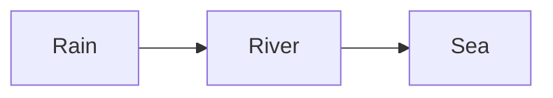
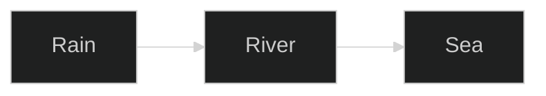

# Four diagrams

A made-up page for the compiler's tests: a diagram that is drawn, one with a title of its own, one the renderer will not hand to its library, and one that cannot be drawn.

## Drawn

## With a title of its own

## A diagram the renderer will not draw

Its source holds a directive, which can set a style or a font address, so the renderer never hands it to its library, and nor does the compiler.

## A diagram that cannot be drawn

![[#^broken]]

^broken
