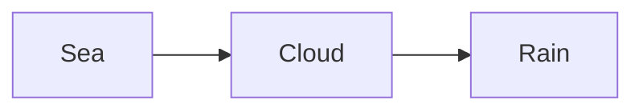

> [!module|trail] A trail map

A made-up booklet for the compiler's tests: two activities, so each is a page of its own, and the first has tabs. One tab holds a body map's figure, another holds a diagram inside a fold the author made, and the second activity holds a diagram too.

> [!activity|where] Where it shows

> [!tab|body] The map

> [!widget|body-map readonly describe] Where do you feel it?
> ![[#^body-map]]

> [!tab|flow] The flow

Rain makes a river, and a river makes a sea.

> [!note]- How the water goes
> The picture is folded away until it is opened.
>
> ```mermaid
> flowchart LR
>   Rain --> River --> Sea
> ```

> [!note]- A second fold
> Nothing but words in this one.

> [!activity|after] Afterwards

A diagram on a page of its own, with no tabs and no folds.



> [!module|trail end] End of A trail map

> [!data|trail] Data for A trail map

```booklet widget
{ "engine": "svg-regions",
  "figures": [
    { "id": "front", "label": "Front",
      "svg": "<svg xmlns=\"http://www.w3.org/2000/svg\" viewBox=\"0 0 100 160\" aria-hidden=\"true\" focusable=\"false\">\n  <ellipse class=\"outline\" cx=\"50\" cy=\"20\" rx=\"16\" ry=\"18\"/>\n  <rect class=\"rg\" data-r=\"head\" x=\"30\" y=\"0\" width=\"40\" height=\"40\"/>\n  <path class=\"rg\" data-r=\"chest\" d=\"M30 44 Q50 38 70 44 L68 84 Q50 90 32 84 Z\"/>\n</svg>",
      "regions": ["head", "chest"] } ],
  "regions": [
    { "id": "head", "label": "Head" },
    { "id": "chest", "label": "Chest" } ],
  "senses": [ { "id": "warm", "words": [ { "id": "hot", "label": "Hot" } ] } ],
  "copy": { "h": "Body map", "p": "Point to where you feel it." } }
```
^body-map
