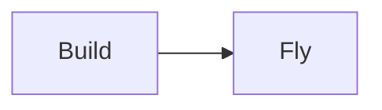
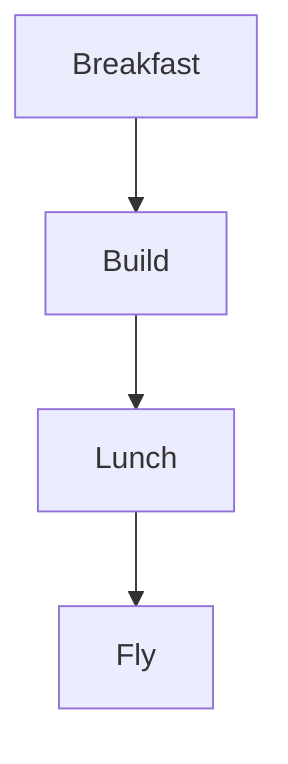

> [!module|kites] A kite workshop

> [!notice]
> license: CC BY 4.0
> copyright: © 2026 Example Press
> source: https://example.org/kites/
> version: 0.1

A made-up booklet for the compiler's tests: every callout kind, every question kind, both widget engines, and each thing the compiler marks instead of drawing.

> [!activity|looks] Every callout look

The seventeen kinds, each in its own look.

> [!note] A note
> Bring string, tape and a spare spar.

> [!abstract] An abstract
> A short day: build in the morning, fly after lunch.

> [!info] Some information
> The field opens at nine.

> [!todo] A thing to do
> Cut the sail before the glue is out.

> [!tip] A tip
> Tape the corners twice.

> [!important] Something important
> Keep the line off the path.

> [!success] It flew
> The first kite rose on the second try.

> [!question] A question
> Why does a longer tail steady a kite?

> [!warning] A warning
> Stay away from overhead wires.

> [!failure] It fell
> The sail tore along the fold.

> [!danger] Danger
> Never fly in a thunderstorm.

> [!bug] A bug
> The bridle knot slips when it is wet.

> [!example] An example
> A diamond kite with a ribbon tail.

> [!quote] A quotation
> Wind is the kite's whole engine.

> [!diff] Your plan says three spars
> Two are enough for a diamond.

> [!law] The field's rule
> Lines no longer than thirty metres.

> [!opinion] One view
> Paper sails fly better than plastic ones.

Two more: a kind written by another name, and one this compiler does not know.

> [!tldr] Written as tldr
> It takes the abstract's look.

> [!sparkle|shine] Sparkle
> A kind with an id that the format does not define.

A group, folds and a fold of a kind.

> [!group] What to pack
> String, tape, scissors.
>
> > [!text|pack-more] Anything else to pack?

> [!group]-
> Two dowels and a sheet of tissue, for a second kite.

> [!warning]- Folded: the wind limit
> Pack up when the wind passes thirty kilometres an hour.

> [!activity|asks] Every question kind

> [!text|name] What will you call your kite?
> One or two words.

> [!lines|steps] The steps you followed

> [!number|spars min:1 max:6 step:1] How many spars?

> [!date|flown] When did it first fly?

> [!choice|shape open] Which shape did you build?
- [ ] Diamond
- [ ] Box
- [ ] Delta

> [!hint]- Hint
> Count the corners.

> [!solution]- Solution
> A diamond has four.

> [!multi|tools] Which tools did you use?
- [ ] Scissors
- [ ] Ruler
- [ ] Glue

> [!text|tool-why each:tools] Why that tool?

> [!scale|steady] How steady was it?

0. Wobbly
1. Fair
2. Steady

> [!matrix|weather] How did each wind feel?
- A light breeze
- A strong gust

0. Too little
1. Right
2. Too much

> [!hint] A hint drawn outside its question

> [!widget|sky-feel] The flight
> ![[#^flight-grid]]

> [!widget|parts-map readonly describe] Where it broke
> ![[#^kite-parts]]

> [!widget|plain-grid] An uncoloured grid
> ![[#^plain-grid]]

> [!activity|left-off] What the compiler leaves off

A query view, a diagram, a figure, a link to a booklet that is not compiled with this one, a broken citation mark, and two widgets it cannot draw.

```booklet query
from: flights
as: table
```

```booklet data
[ { "label": "Morning", "value": 3 }, { "label": "Afternoon", "value": 5 } ]
```
^flights



The day, as a figure: ![[#^day-plan]]

See also [[spare-kites.booklet]] and a mark that names nothing.[^nowhere]

> [!widget|odd] An engine nobody draws
> ![[#^odd-engine]]

> [!widget|gone] A widget that is not in the file
> ![[#^no-such-widget]]

> [!activity|tabbed] A day in two tabs

> [!tab] Morning

Build the frame.

***

Then the sail.

> [!tab] Afternoon

Fly it, and see [[#Morning]].

> [!activity|draft-notes hidden] Hidden notes

Never on the page.

> [!module|kites end] End of A kite workshop

> [!data|kites] Data for A kite workshop

```booklet widget
{ "engine": "grid-select",
  "axes": { "top": "higher", "bottom": "lower", "left": "calmer", "right": "gustier" },
  "cells": [
    { "id": "soar", "label": "Soaring", "note": "High and calm.", "color": "blue" },
    { "id": "dance", "label": "Dancing", "note": "High and gusty.", "color": "purple" },
    { "id": "drag", "label": "Dragging", "note": "Low and calm.", "color": "slate" },
    { "id": "dive", "label": "Diving", "note": "Low and gusty.", "color": "amber" } ],
  "items": [
    { "id": "glide", "cell": "soar", "label": "Glide" }, { "id": "loop", "cell": "dance", "label": "Loop" },
    { "id": "sag", "cell": "drag", "label": "Sag" }, { "id": "plunge", "cell": "dive", "label": "Plunge" } ],
  "copy": { "h": "Flight", "p": "Pick what the kite did." } }
```
^flight-grid

```booklet widget
{ "engine": "grid-select",
  "cells": [ { "id": "a", "label": "First" }, { "id": "b", "label": "Second" }, { "id": "c", "label": "Third" }, { "id": "d", "label": "Fourth" } ],
  "items": [ { "id": "x", "cell": "a", "label": "Ex" } ],
  "copy": { "h": "Plain", "p": "No colour names." } }
```
^plain-grid

```booklet widget
{ "engine": "svg-regions",
  "figures": [
    { "id": "front", "label": "Front", "svg": "<svg viewBox=\"0 0 100 100\"><rect class=\"rg\" data-r=\"sail\" x=\"10\" y=\"10\" width=\"80\" height=\"60\"/><rect class=\"rg\" data-r=\"tail\" x=\"45\" y=\"70\" width=\"10\" height=\"25\"/></svg>", "regions": ["sail", "tail"] },
    { "id": "back", "label": "Back", "svg": "<svg viewBox=\"0 0 100 100\"><rect class=\"rg\" data-r=\"spar\" x=\"48\" y=\"5\" width=\"4\" height=\"90\"/></svg>", "regions": ["spar"] } ],
  "regions": [
    { "id": "sail", "label": "Sail", "note": "The cloth or paper." },
    { "id": "tail", "label": "Tail", "note": "Keeps it pointing up." },
    { "id": "spar", "label": "Spar", "note": "The stick that holds it open." } ],
  "copy": { "h": "Parts", "p": "Which part gave way?" } }
```
^kite-parts

```booklet widget
{ "engine": "weather-vane", "points": 8 }
```
^odd-engine


^day-plan
